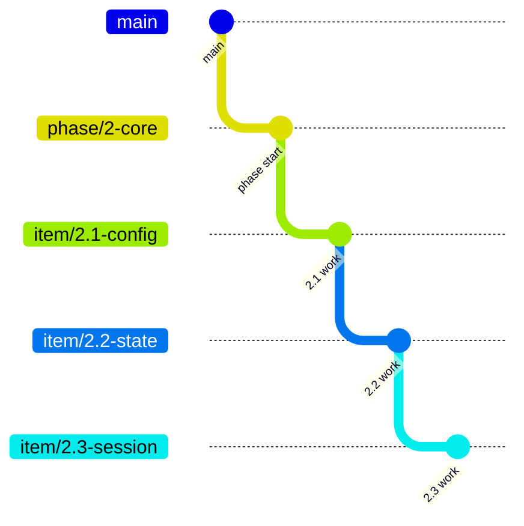
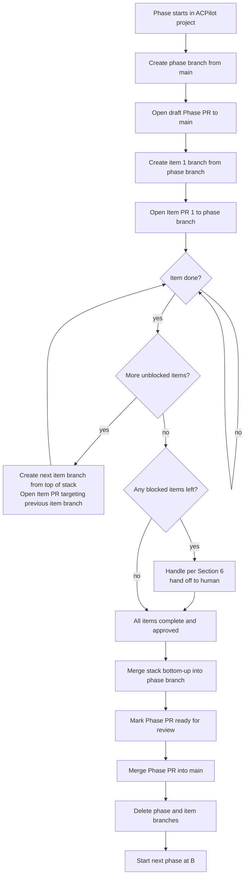
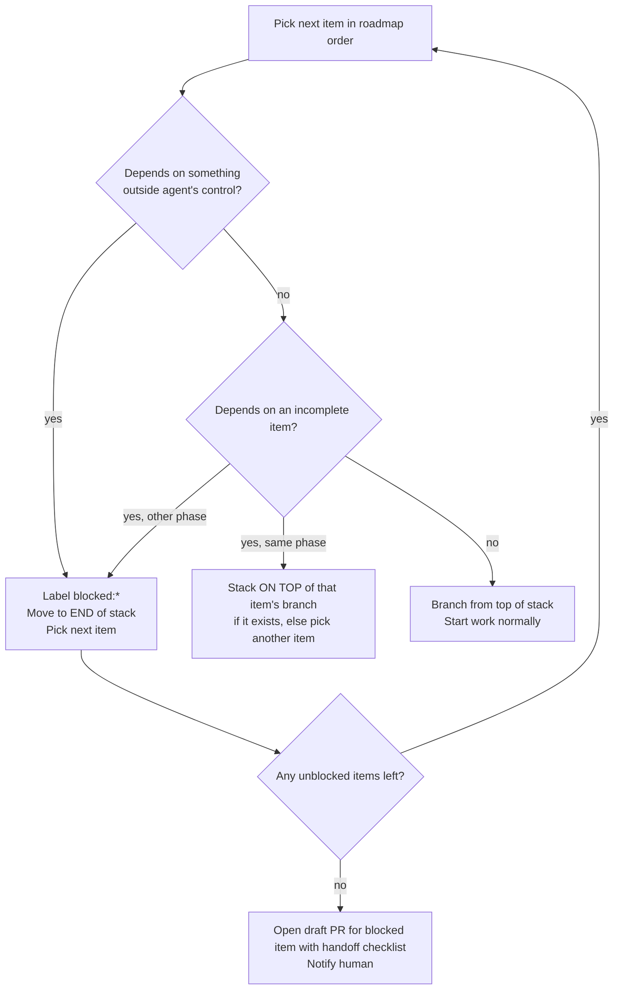

# ACPilot Git Workflow: Phase Branches and Stacked PRs
 
> **Audience:** the coding agent (primary) and human maintainers (diagrams and recovery).
> **When to read this:** at the start of every session, before opening any branch or PR, and any time the repo state looks wrong.
> **Source of truth for scope:** the GitHub Project **ACPilot** (roadmap grouped into phases).
 
---
 
## 1. The rules
 
1. **Never commit directly to `main` or to a `phase/*` branch.** All work happens on `item/*` branches.
2. **Every phase has one phase branch and one phase PR** (`phase/*` → `main`). It is opened the moment the phase starts and stays open (draft) until the phase is complete.
3. **Every roadmap item has one item branch and one item PR.** Item PRs form a **stack** on top of the phase branch.
4. **Invariant:** at all times there is **at least one open phase PR and at least one open current-item PR.** If either is missing, fix that before doing anything else (see [Recovery](#9-recovery-playbook-when-things-go-astray)).
5. **The stack is merged bottom-up into the phase branch when the phase is complete**, then the phase PR is merged into `main`.
6. **Exceptions** (blocked or externally-dependent items such as Windows/WSL integration) follow [Section 6](#6-exceptions-blocked-and-externally-dependent-items). They go **last** in the stack and are never faked.
7. **When unsure, stop and ask the human.** Do not improvise history rewrites on shared branches.
8. **Every branch and every PR title carries its number**: the phase number for phase branches/PRs, and the phase.sequence plus issue (ticket) number for item branches/PRs.
9. **Every commit follows Conventional Commits 1.0.0 and starts its description with a gitmoji**: `type(scope): ✨ description`. See [§3.3](#33-commit-messages-conventional-commits--gitmoji).
10. **Every commit and PR references its ticket with GitHub keywords** (`Refs #123` while working, `Closes #123` when finished) so tickets move automatically. See [§3.4](#34-linking-and-auto-moving-tickets).
---
 
## 2. Vocabulary
 
| Term | Meaning |
|---|---|
| **Phase** | A group of roadmap items in the ACPilot GitHub Project (e.g. "Phase 2: Core Pilot Loop"). |
| **Item** | A single roadmap card/issue inside a phase. |
| **Phase branch** | Long-lived integration branch for one phase. Branches from `main`. |
| **Item branch** | Short-lived branch for one item. Stacked on the previous item branch (or on the phase branch if it is first). |
| **Stack** | The ordered chain: `main` ← phase ← item 1 ← item 2 ← … ← item N. |
| **Current item** | The item the agent is actively working on. It is the top of the stack (unless blocked, see §6). |
| **Blocked item** | An item that cannot be completed by the agent now (external dependency or unfinished prerequisite). |
 
---
 
## 3. Naming, commits, and ticket linking
 
### 3.1 Branch naming
 
| Branch | Pattern | Example |
|---|---|---|
| Main | `main` | `main` |
| Phase | `phase/<phase-number>-<slug>` | `phase/2-core-pilot-loop` |
| Item | `item/<phase-number>.<seq>-<issue-number>-<slug>` | `item/2.3-47-session-persistence` |
 
**Rule: a branch name without its number is invalid.**
 
- Phase branches contain the **phase number** (`phase/2-…`).
- Item branches contain **both** the phase.sequence (`2.3`) **and** the GitHub issue/ticket number (`47`).
- `<seq>` is the item's position in the stack within its phase (1, 2, 3…). It reflects **stack order**, not priority.
- Slugs are lowercase, hyphenated, ≤ 5 words.
### 3.2 PR titles and bodies
 
**Rule: a PR title without its number is invalid.**
 
| PR | Title pattern | Example |
|---|---|---|
| Phase | `Phase <N>: <Phase name>` | `Phase 2: Core Pilot Loop` |
| Item | `[<N>.<seq>] <item title> (#<issue>)` | `[2.3] Session persistence (#47)` |
 
- **Phase PR body:** first line `Stack: phase root`. A checklist of every item in the phase. And one **closing keyword per item** (`Closes #41`, `Closes #44`, …) plus the phase's own tracking issue if there is one. Keep it updated as items complete.
- **Item PR body:** first line `Stack: 3 of 5 · base: item/2.2-… · phase: #101`. Then `Closes #<issue>`. Then what changed, how it was tested, and what the next item in the stack depends on from this one.
- Item PRs link their issue with a closing keyword **from the start** (even as drafts). That is what attaches the PR to the ticket and moves the card.
### 3.3 Commit messages (Conventional Commits + gitmoji)
 
Sources: [Conventional Commits 1.0.0](https://www.conventionalcommits.org/en/v1.0.0/#specification) and the [gitmoji specification](https://gitmoji.dev/specification).
 
```
<type>(<scope>): <gitmoji> <description>
 
[optional body]
 
<Refs|Closes> #<issue>
```
 
**Why the emoji sits after the colon.** Conventional Commits requires every commit to *start with* the type. The gitmoji spec puts the emoji first. We satisfy both by putting the gitmoji as the first thing in the description. The message stays valid Conventional Commits (tools can still parse type, scope, and description). The intention emoji is still the first visual marker after the prefix. If you ever drop Conventional Commits tooling, the emoji can move to the front without losing anything.
 
**Rules**
 
1. **`type`** is one of the Conventional Commits types: `feat`, `fix`, `docs`, `style`, `refactor`, `perf`, `test`, `build`, `ci`, `chore`, `revert`. Use `feat` only for new features and `fix` only for bug fixes.
2. **`scope`** is a **noun for the area of the codebase** (`session`, `config`, `wsl-bridge`), lowercase. The spec requires a noun, so **do not use the ticket number as the scope**. The ticket goes in the footer. Phase-level housekeeping commits use `phase-<N>` (e.g. `chore(phase-2): …`).
3. **gitmoji** is the **unicode emoji** (not the `:shortcode:`), placed right after `: `, chosen from the gitmoji list by *intention*. Defaults are in the table below.
4. **`description`** is imperative, lowercase, with no trailing period. The whole first line is **≤ 72 characters**.
5. **Footer** always references the ticket: `Refs #<issue>` on work-in-progress commits, `Closes #<issue>` on the final commit of an item (see §3.4). Footers use `Token #value` or `Token: value` format.
6. **Breaking changes:** add `!` before the colon, **and** a `BREAKING CHANGE: <explanation>` footer, and use 💥 as the gitmoji.
7. **One logical change per commit.** If two types apply, make two commits.
8. **Merge commits and squash commits** follow the same format (see §5.5).
**Default gitmoji by type**
 
| Type | Default gitmoji | Other common choices |
|---|---|---|
| `feat` | ✨ new feature | 🚩 feature flags · 🏗️ architectural change · 💥 breaking change |
| `fix` | 🐛 bug fix | 🩹 simple non-critical fix · 🚑️ critical hotfix · 🔒️ security fix · 🥅 catch errors |
| `docs` | 📝 documentation | ✏️ typos · 💬 text/literals |
| `style` | 🎨 structure/format of code | 🚨 fix linter warnings |
| `refactor` | ♻️ refactor code | 🚚 move/rename · 🔥 remove code or files |
| `perf` | ⚡️ performance | |
| `test` | ✅ add/update tests | 🧪 add a failing test |
| `build` | 📦️ build/packages | ⬆️ upgrade deps · ⬇️ downgrade deps · 📌 pin deps |
| `ci` | 👷 CI build system | 💚 fix CI |
| `chore` | 🔧 config files | 🎉 start a phase · 🚧 work in progress / start an item · 🔀 merge branches · 🙈 `.gitignore` · 🔖 release/version tag |
| `revert` | ⏪️ revert changes | |
 
**Examples**
 
```
chore(phase-2): 🎉 start Phase 2: Core Pilot Loop
 
chore(session): 🚧 start session persistence
 
Refs #47
 
feat(session): ✨ persist pilot sessions to disk
 
Refs #47
 
fix(config): 🐛 handle missing config file on first run
 
Refs #41
 
refactor(state): ♻️ extract transition table
 
Refs #44
 
test(session): ✅ cover corrupt session file recovery
 
Closes #47
 
feat(wsl-bridge)!: 💥 change socket path to per-user runtime dir
 
BREAKING CHANGE: clients must read the path from ACPILOT_SOCKET.
 
Refs #52
```
 
**Quick validity check** (first line. Usable in a `commit-msg` hook):
 
```regex
^(feat|fix|docs|style|refactor|perf|test|build|ci|chore|revert)(\([a-z0-9-]+\))?!?: \S+ .+$
```
 
### 3.4 Linking and auto-moving tickets
 
GitHub moves/closes tickets from keywords in **PR descriptions and commit messages**.
 
| Intent | Keywords (any works, case-insensitive) | Use on |
|---|---|---|
| **Close** the ticket | `close`, `closes`, `closed`, `fix`, `fixes`, `fixed`, `resolve`, `resolves`, `resolved` | Final commit of an item · item PR body · squash-merge commit · phase PR body (one per item) · phase merge commit |
| **Link only** (do not close) | `Refs #123` (or just `#123`) | Intermediate/WIP commits · "start" commits |
 
Format reminders:
 
- **One keyword per issue.** `Closes #41, closes #44`, not `Closes #41, #44` (the second would not close).
- The keyword goes in a **commit footer** (`Closes #47`) or the **PR body**. It does not work in the PR title.
- Cross-repo: `Closes owner/repo#123`.
**Important: why issues don't close when an item merges.** GitHub only auto-closes an issue when the closing PR/commit reaches the repo's **default branch** (`main`). Item PRs merge into a **phase branch**. Their `Closes #47` links the PR to the ticket and moves the card. But **the issue itself stays open until the phase PR merges into `main`**. That is why the phase PR body and phase merge commit repeat a `Closes #…` for every item. They close everything in one go when the phase lands.
 
**Card movement** (ACPilot project board). Recommended mapping:
 
| Event | Card status | How |
|---|---|---|
| Item PR opened (draft) with `Closes #N` | In Progress | Project workflow, or agent sets it |
| Item PR marked ready for review | In Review | Project workflow, or agent sets it |
| Item PR merged into the phase branch | Done (issue still open) | Project workflow "Pull request merged", or agent sets it |
| Phase PR merged into `main` | Issue closed | Automatic via `Closes #…` |
| Item blocked (§6) | Blocked | Agent sets it |
 
> **Humans: check your ACPilot project's *Workflows* settings.** Built-in workflows (e.g. pull request merged, item closed, auto-add to project) vary by plan and setup. Wherever one is missing, the agent updates the card itself (e.g. with `gh project item-edit`) at the events above. Status names here are placeholders. Match them to your board.
 
---
 
## 4. The branching scheme
 
### 4.1 Diagram (stack shape)
 
```
main
 └── phase/2-core-pilot-loop            ← Phase PR  (→ main)          [draft until complete]
      └── item/2.1-41-config-loader     ← Item PR   (→ phase/2-…)
           └── item/2.2-44-state-machine     ← Item PR (→ item/2.1-…)
                └── item/2.3-47-session-persistence   ← Item PR (→ item/2.2-…)   ◀ current item
                     └── item/2.4-52-windows-wsl-bridge   ← Item PR (→ item/2.3-…) [blocked, last]
```
 
Each PR's **base branch is the branch directly beneath it**. Never target `main` from an item branch.
 
### 4.2 Diagram (git history)
 

 
### 4.3 Diagram (lifecycle of a phase)
 

 
---
 
## 5. Procedures
 
> Replace `<…>` placeholders. Prefer the `gh` CLI. Always run `git fetch --all --prune` first.
 
### 5.1 Starting a phase
 
Trigger: the human says a phase is starting, or the first item of a new phase is moved to *In Progress*.
 
```bash
git fetch --all --prune
git switch main && git pull --ff-only
 
# 1. Phase branch
git switch -c phase/<N>-<slug>
git commit --allow-empty -m "chore(phase-<N>): 🎉 start Phase <N>: <Phase name>"
git push -u origin phase/<N>-<slug>
 
# 2. Phase PR (draft): checklist of all items + one closing keyword per item
gh pr create --draft --base main --head phase/<N>-<slug> \
  --title "Phase <N>: <Phase name>" \
  --body $'Stack: phase root\n\n## Items\n- [ ] #<issue-a> <title>\n- [ ] #<issue-b> <title>\n\nCloses #<issue-a>\nCloses #<issue-b>'
# (add "Closes #<phase-tracking-issue>" too, if the phase has its own issue)
```
 
Then immediately start the first item (5.2). **A phase PR must never exist without a current item PR.**
 
### 5.2 Starting an item
 
Pick the next item in roadmap order that is **not blocked** (see §6). Branch from the **top of the stack**, which is the latest item branch, or the phase branch if this is the first item.
 
```bash
git fetch --all --prune
git switch <top-of-stack-branch>
git pull --ff-only
git switch -c item/<N>.<seq>-<issue>-<slug>
 
git commit --allow-empty -m "chore(<scope>): 🚧 start <item title>" -m "Refs #<issue>"
git push -u origin item/<N>.<seq>-<issue>-<slug>
 
gh pr create --draft \
  --base <top-of-stack-branch> \
  --head item/<N>.<seq>-<issue>-<slug> \
  --title "[<N>.<seq>] <item title> (#<issue>)" \
  --body $'Stack: <seq> of <total> · base: <top-of-stack-branch> · phase: #<phase-pr>\n\nCloses #<issue>'
```
 
Also update the phase PR checklist and move the card to *In Progress* in the ACPilot project.
 
### 5.3 Working on an item
 
- Commit small and often. **Every commit** uses `type(scope): <gitmoji> description` (§3.3) and ends with a footer: `Refs #<issue>` normally, `Closes #<issue>` on the item's final commit (§3.4).
- Push regularly. Only force-push **your own item branch**, and only with `--force-with-lease`.
- Keep the PR description current. Mark **Ready for review** when the item is done and tests pass.
- **Do not** start the next item's *code* on the same branch. Finish, then branch (5.2).
### 5.4 Keeping the stack healthy (restacking)
 
If a lower branch changes (review feedback, a fixup, a rebase), every branch above it must be rebased onto its parent, **bottom to top**:
 
```bash
# for each branch above the changed one, in order:
git switch item/<child>
git rebase --onto <new-parent-tip> <old-parent-tip> item/<child>
git push --force-with-lease
```
 
Tip: record the old parent tip *before* you change it (`git rev-parse <parent>`), because `--onto` needs it. If it is lost, use `git reflog`.
 
Optional tooling that automates this: [Graphite](https://graphite.dev) (`gt`), `git-spice`, or `git-branchless`. Use one only if the human has opted in. Otherwise stick to plain git and `gh`.
 
### 5.5 Completing a phase (merging the stack)
 
Preconditions (check all. Stop and ask if any fail):
 
- [ ] Every item in the phase is either **merged-ready** or has an approved exception (§6).
- [ ] CI is green on the top of the stack.
- [ ] Item PRs have been reviewed/approved.
Merge **bottom-up**, one at a time, into the phase branch:
 
```bash
# For item 1 (base is the phase branch). The squash commit is itself a
# Conventional Commit with a gitmoji and the closing keyword:
gh pr merge <item1-pr> --squash --delete-branch=false \
  --subject "feat(config): ✨ add config loader" \
  --body "Closes #41"
 
# Then retarget item 2 to the phase branch and rebase it onto the updated phase branch:
gh pr edit <item2-pr> --base phase/<N>-<slug>
git fetch origin
git switch item/<N>.2-…
git rebase --onto origin/phase/<N>-<slug> <old-item1-tip> item/<N>.2-…
git push --force-with-lease
gh pr merge <item2-pr> --squash \
  --subject "feat(state): ✨ add pilot state machine" \
  --body "Closes #44"
 
# …repeat for each remaining item, in order.
```
 
When the stack is fully merged into the phase branch:
 
```bash
gh pr ready <phase-pr>                # take it out of draft
gh pr merge <phase-pr> --merge \
  --subject "chore(phase-<N>): 🔀 merge Phase <N>: <Phase name>" \
  --body $'Closes #<issue-a>\nCloses #<issue-b>'   # closes every item issue on main
```
 
Then: remove merged item/phase branches, close the phase's cards, and **start the next phase (5.1)**.
 
> Merge strategy: items are **squashed** into the phase branch (one commit per item). The phase is merged into `main` with a **merge commit** so the phase boundary is visible in history. Squash and merge commit subjects must be Conventional Commit + gitmoji, and must carry the closing keywords (§3.4). Never accept GitHub's default merge message if it does not. Change this strategy only if the human says so.
 
---
 
## 6. Exceptions: blocked and externally-dependent items
 
Some items cannot be finished by the agent when their turn comes up. Typical cases:
 
| Case | Example | Handling |
|---|---|---|
| **External environment dependency** | Windows ↔ WSL integration must be built and tested on **Windows**, but the agent works in **WSL**. | Defer to the **end** of the phase's stack. Hand off to the human (see below). |
| **Prerequisite item not complete** | Item B needs the API from Item A. | Stack B **on top of A** (never on a sibling). Don't start B until A has a working branch. |
| **Prerequisite in a later/other phase** | Item needs something scheduled for Phase 4. | Do not start it. Flag to the human. Leave the card in *Blocked*. |
| **Needs a human decision/credential/hardware** | Signing certs, design choice. | Mark blocked, ask the human, continue with the next unblocked item. |
 
### Rules for blocked items
 
1. **Label** the issue and PR `blocked` plus a reason label, e.g. `blocked:external-windows`, `blocked:dependency`, `blocked:decision`. Put the reason in the first lines of the PR body.
2. **Order:** blocked items go **last** in the stack. Unblocked items are never made to wait on them.
3. **Do not fake it.** No stubs that pretend the feature works, no mocked-out "done" implementations, no untested code claiming to cover the Windows side. A **design/interface-only** branch is fine if clearly labelled as such.
4. **Keep the invariant.** If only blocked items remain, the **current item PR** is the blocked item's **draft PR**, opened with a handoff checklist (below). The invariant "at least one current item PR" still holds.
5. **Hand-off checklist** in the PR body for externally-dependent items:
   - [ ] What is already done on the WSL/agent side (links to commits)
   - [ ] Exact steps/commands the human must run on Windows
   - [ ] Interfaces/contracts the Windows side must satisfy
   - [ ] How to check it works
   - [ ] Which branch to continue on (it will be this PR's branch)
6. **Phase completion with a blocked item:** the phase is **not complete** until the blocked item is merged. The human may explicitly say to **carry it over** to the next phase. In that case: retarget/re-create its PR in the new phase's stack as item 1.x and note the carry-over in both phase PRs.
### Decision flowchart
 

 
---
 
## 7. Expected repository states
 
### 7.1 Healthy (mid-phase)
 
- `main` is untouched by item work.
- 1 open **draft Phase PR** (`phase/*` → `main`).
- ≥ 1 open **Item PR**, each based on the branch beneath it. The top one is the current item.
- Every open PR is linked from the phase PR checklist.
- Cards in the ACPilot project match PR state (*In Progress*, *In Review*, *Blocked*, *Done*).
### 7.2 Healthy (phase boundary)
 
Between "last item merged into the phase" and "next phase started", there may briefly be no item PR. This window must be **minutes, not days**. Start the next phase immediately after merging the phase PR.
 
### 7.3 Unhealthy (needs recovery)
 
- An item PR targets `main`.
- A phase PR has no open item PR above it (and unblocked work remains).
- An item branch was created from `main` or from the wrong parent.
- Two item branches share the same parent (a fork in the stack).
- Commits exist directly on `main` or `phase/*` that are not from a merged PR.
- A PR shows hundreds of unrelated commits (stale base).
- A branch or PR title is missing its phase/ticket number.
- Commits that are not Conventional Commits, have no gitmoji, or have no `Refs`/`Closes` footer.
- An item PR has no closing keyword linking it to its ticket.
---
 
## 8. Guardrails for the agent
 
**Always**
- `git fetch --all --prune` and check `git status` before starting any task.
- Check the base branch of every PR you open.
- Keep PRs small and scoped to one roadmap item.
- Update the phase PR checklist and project card whenever state changes.
- Put the phase number or issue number in every branch name and PR title.
**Never**
- Push to `main` or `phase/*` directly.
- Force-push (`--force`) anywhere. `--force-with-lease` on your own item branch only.
- Rewrite history on a branch someone else has pushed to.
- Merge a PR out of stack order.
- Write a commit that is not `type(scope): <gitmoji> description`, or that omits the ticket footer.
- Put the ticket number in the commit *scope* (scope is a noun. Ticket goes in the footer).
- Use `Closes` on intermediate commits (use `Refs`).
- Remove a branch that still has an open PR targeting it.
- Mark a blocked item done, or work around a block by faking functionality.
**Ask the human first when**
- A rebase produces conflicts you are not certain how to resolve.
- You need to reorder, split, or drop an item in the stack.
- A phase is ready to merge into `main`.
- You are about to do anything destructive (`reset --hard`, deleting remote branches, closing PRs).
---
 
## 9. Recovery playbook (when things go astray)
 
Start every recovery with:
 
```bash
git fetch --all --prune
git status
git branch -vv
gh pr list --state open --json number,title,baseRefName,headRefName,isDraft
git log --oneline --graph --decorate --all -n 40
```
 
Compare the output against §4.1 and §7.
 
| Symptom | Fix |
|---|---|
| **No phase PR exists** for the current phase | Run 5.1 (the phase branch may already exist. If so, just open the draft PR). |
| **Phase PR exists but no current item PR** | Run 5.2 for the next unblocked item. If all remaining items are blocked, open the blocked item's draft PR per §6. |
| **Item PR targets the wrong base** (e.g. `main`) | `gh pr edit <pr> --base <intended-parent>`. Then rebase the branch onto the intended parent (5.4). |
| **Item branch was created from the wrong parent** | `git rebase --onto <intended-parent> <wrong-parent> <item-branch>`. Push with `--force-with-lease`. Fix PR base. |
| **Two item branches fork from the same parent** | Choose the intended order (ask the human if unclear). Rebase the later one onto the earlier: `git rebase --onto <earlier-item> <shared-parent> <later-item>`. |
| **Lower PR was amended / rebased. Upper PRs look broken** | Restack bottom-up (5.4). Use `git reflog` to recover the old parent tip. |
| **Lower PR was squash-merged and upper PRs now show extra commits** | Expected with squash merges. For each remaining item, bottom-up: `git rebase --onto <phase-branch> <old-merged-item-tip> <item-branch>`, retarget base to the phase branch, force-push with lease. |
| **Commits landed directly on `main` or a phase branch** | **Stop.** Do not reset or force-push. Tell the human. Likely fix is a revert PR or merging `main` into the phase branch, chosen by the human. |
| **Work committed to the wrong branch** | `git switch <right-branch> && git cherry-pick <sha…>`. Then on the wrong branch, `git revert` (if pushed) or ask the human before resetting. |
| **Merge conflicts during restack** | Resolve only if the intent is obvious. Otherwise `git rebase --abort` and ask the human. |
| **Lost commits after a bad rebase/reset** | `git reflog` → find the SHA → `git branch rescue/<name> <sha>`. Then continue from the rescue branch. |
| **Commit messages don't follow §3.3** (unmerged, on your own item branch) | `git rebase -i <parent-branch>` and `reword` each commit. Push with `--force-with-lease`. Restack branches above (5.4). If already merged to a phase branch, leave history alone and tell the human. |
| **Branch or PR name missing its number** | Rename the PR title with `gh pr edit`. For a branch: `git branch -m <old> <new>`, push the new name, remove the old remote branch, and re-point any PRs stacked on it (`gh pr edit <child> --base <new>`). Ask the human first if other PRs depend on it. |
| **Ticket didn't move / issue still open after item merged** | Expected: item PRs merge into a phase branch, not `main` (§3.4). Set the card status manually if no project workflow does it. After the phase merges to `main`, check the issues closed. If not, check the phase PR body has `Closes #…` for each. |
| **Issue linked to the wrong PR** | Edit the PR body to remove the wrong keyword and add the right one. For commit footers, reword (above). |
| **Stale local state vs. GitHub** | `git fetch --all --prune`. Compare `git rev-parse origin/<branch>` to local. Fast-forward with `git pull --ff-only`. If it cannot fast-forward, ask the human. |
| **Phase PR has unrelated changes** | Compare `git diff main...phase/<N>-<slug> --stat` with the item list. Anything unexpected is flagged to the human, not silently removed. |
| **Blocked item stalls the phase** | Check status with the human: wait, or carry over to the next phase (§6.6). |
| **Unsure which phase/item is current** | Check the ACPilot project board: *In Progress* items define the current phase/item. If the board and git disagree, report the mismatch and ask. |
 
### Quick audit checklist
 
- [ ] `main` contains only merged phase work
- [ ] Exactly one open phase PR per active phase
- [ ] Each item PR's base = the branch directly beneath it in the stack
- [ ] No forks in the stack (each branch has at most one open child)
- [ ] Blocked items are last, labelled, and have a hand-off checklist
- [ ] Every branch and PR title contains its phase number / ticket number
- [ ] Every commit is `type(scope): <gitmoji> description` with a `Refs`/`Closes` footer
- [ ] Every item PR body has `Closes #<issue>`. The phase PR body has `Closes #…` for every item
- [ ] Phase PR checklist matches reality
- [ ] ACPilot board statuses match PR states
---
 
## 10. Worked example
 
Phase 2 has four items. Item 2.4 is the Windows/WSL bridge.
 
```
Day 0   Phase starts
        main
         └─ phase/2-core-pilot-loop            PR #101 (draft → main)
             └─ item/2.1-41-config-loader      PR #102 (→ phase/2-…)        ◀ current
 
Day 2   2.1 done, 2.2 started
         └─ phase/2-core-pilot-loop            PR #101
             └─ item/2.1-41-config-loader      PR #102 ✔ ready
                 └─ item/2.2-44-state-machine  PR #103 (→ item/2.1-…)       ◀ current
 
Day 5   2.3 started; 2.4 is blocked:external-windows → goes last
         └─ phase/2-core-pilot-loop            PR #101
             └─ item/2.1-41-config-loader      PR #102 ✔
                 └─ item/2.2-44-state-machine  PR #103 ✔
                     └─ item/2.3-47-session    PR #104                       ◀ current
                         └─ item/2.4-52-wsl    PR #105 (draft, blocked)
 
Day 8   Only 2.4 left. Agent finishes WSL side, adds hand-off checklist, pings human.
        Human completes Windows work on item/2.4-52-wsl, PR #105 becomes ready.
 
Day 9   Merge bottom-up: #102 → #103 → #104 → #105 into phase/2-…
        Mark #101 ready, merge into main.
        Immediately start Phase 3 (phase branch + PR + item 3.1 PR).
```
 
---
 
## 11. Maintenance notes (for humans)
 
- If you change the naming scheme, merge strategy, or exceptions, edit this file. Agents should treat it as authoritative.
- Suggested repo settings: protect `main` and `phase/*` (require PR + passing checks, block force-pushes), and enable *Automatically delete head branches*.
- Suggested commit enforcement: [commitlint](https://commitlint.js.org) with `@commitlint/config-conventional` plus a `commit-msg` hook (or the regex in §3.3) to reject non-conforming messages. Optionally the gitmoji-cli hook to help pick emojis.
- Enable the ACPilot project's built-in workflows noted in §3.4 so cards move without the agent.
- Suggested labels: `blocked`, `blocked:external-windows`, `blocked:dependency`, `blocked:decision`, `phase`, `item`, `stack`.
- Suggested pointer in `AGENTS.md` / `CLAUDE.md`: *"All git and PR work must follow `GIT_WORKFLOW.md`. Re-read it whenever repo state is unexpected."*
 