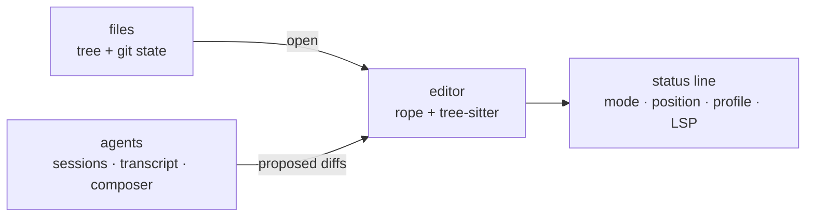

hangar &nbsp; Editor phase (P6)

The terminal UI is the primary interface, not the fallback. It runs over an SSH
session, inside tmux, on a machine with no GPU. It is also the reason the daemon
exists: close the laptop, reconnect, and the turn is still running.

[The showcase](/acpilot/showcase/) replays its screens in a browser. The frames
are painted by this crate, in any theme, including one solved from a pair of
colours you pick.

## Layout

Panels are the same three in every UI: files, text, agents. The mental model
should not change when you change cockpit.

The footer carries the stats bar. It has one row per integration, a context track
and a credit track, and a name per row even when it has nothing to report. A window
nobody reported is drawn as an indeterminate track, not a full or an empty one.
An estimate is marked and coloured as an estimate. `F4` swaps every figure for
the source behind it. The desktop app and the page draw the same rows, because
`acpilot-stats` does the measuring rather than each frontend.

The colours are not this crate's. Every pane, card and status label is drawn from
the theme tokens the desktop app and the browser read. The tokens resolve from
`theme_tui` (over `theme`) in the project's settings. A theme is an extension, so one pack
recolours all three surfaces at once. A project can choose a different one
without changing anything global. Saving the settings file is the recolour. The
client watches the user's and the project's `config.toml`, and the status bar
names the theme it switched to. Editing `theme_tui` in one window is therefore
not a note to restart in another. The daemon's answer outranks that watch. The
profile-wide event stream opens with the preferences the daemon would apply and
sends a new set after every save. A client attached to a daemon whose files it
cannot see, such as a remote host or a container, still follows `theme_tui`. The
file watch is the fallback for a client with no daemon, or a daemon too old to
announce them. `theme_follow_terminal = true` instead asks the terminal for its
own background and foreground when the client starts. It solves a palette around
them, so the terminal UI can match the shell it was opened in rather than the
other way round. A terminal that will not answer keeps the named theme.

## Opening

`acpilot tui README.md` opens the file's project and the file. The keyboard is in
the editor, and no assistant pane is drawn. The window is a text editor before it
is an agent client. The session list, transcript and composer do not exist until
**Session → Select Agent…** (or the palette's **Select agent…**) chooses one. At
that point the agent's newest conversation opens, or a new one starts, and the
panel appears beside the editor. A profile with no `agents.toml` has no agents to
list, so that row names `agents.toml` and `acpilot doctor` rather than opening an
empty picker. **Session → Build an Agent in the Model Lab…** opens the lab page
(P4.5-8): the recipe on the left, its corpus in the middle, and the answer and run
history on the right. `Tab` moves between the three, `Enter` edits a field (or a
run, which opens its record), `Space` flips a tool or the overflow strategy, `^S`
writes the recipe back through the daemon's validation, and `^R` runs it with the
prompt typed after `i`. `v` shows the effective request, `c` marks a run to
compare against, and `r` reloads from the daemon. **Session → Close Assistant**
puts the panel away and leaves the document open. When the daemon reports no declared agents at all, a one-time
**next** card names the two ways forward: **Session → Select Agent…** and
`acpilot doctor`. The next key or click dismisses it. Nothing is written to
remember it was shown. It appears on any start whose profile has no agents, and
not once one does.

## Panels

The editor is the middle of the window, and the columns either side hold panels.
`Alt-P` opens the Panels menu, which says which panel is on which side. A row is a
place (`File manager on the right`). Two panels on one side share the column, and
the arrangement is remembered with the divider widths. Five panels are built
today.

| Panel | What it answers | State |
| --- | --- | --- |
| **File manager** | where the files are, what git says changed about them, and a find over paths and contents | built |
| **Outline** | what the open buffer defines, from the grammar it is highlighted with. `Enter` on a row puts the caret on the definition's line | built |
| **Assistant** | the sessions, the open transcript and the composer, the agent's half of the window, shown once an agent is chosen | built |
| **Project map** | what the workspace is *for*: what each area is for, which path it owns, and what it depends on. The area the open file is in is opened under the list | built |
| **Wiki** | one linked page per subsystem, written from the code so the repository explains itself | hangar |
| **References** | every real use of the identifier under the caret, without the language's own noise. `Enter` on a row opens the file at the use | built |

The one still in the hangar is a panel rather than a screen for the same reason the
others are. It answers a question about *this* workspace while a file is open. It
is read in a column, and it can be put on either side or put away.

**Project map** is a document the agent writes into the workspace:
`.acpilot/project-map.toml`, beside the settings. It says what each area is for,
which path it owns, and which parts it depends on. `GET /v1/project/map` parses it
where the workspace is, so the panel works the same when the files are on another
machine. The areas come back in the order the agent wrote them. A map that sorted
itself would be one whose order nobody chose. The panel marks the area the open
file belongs to. That is the deepest path that is a prefix of it, so a map can
describe the workspace and then refine it. It opens that area's summary and edges, which is the
neighbourhood you are standing in. `j`/`k` choose, `Enter` reads a summary onto the
status line, and `r` re-reads a map that was just rewritten. A repository with no
map yet says so rather than drawing an empty list that would read as a workspace
with nothing in it.

Regenerating a map is a prompt with the tree and the README as its input, not a
model of its own. The result is a file in the repository, so it is versioned and
reviewable. A wrong statement about the architecture is a diff somebody can argue
with instead of a hedge in a chat log.

**Wiki** is the same idea at a larger size. It has one page per subsystem, written
from the code and the map, kept in the workspace and read in a pane. What makes it a
wiki rather than generated documentation is that pages are linked. A link to a
page nobody has written yet is the prompt to write it. The pane needs a page list,
a reader and a jump. It does not need an editor, because the agent is the author
and the repository is the store.

**References** is the question a person asks about a name: where else is this used?
`Shift-F12`, or **Find References** in the View menu, reads the word under the
caret and asks the daemon. The panel lists the answer: the path and line, then the
line's own text with the name marked. What makes the list worth reading is the
parse tree. A row is a leaf the grammar calls a name. The comment that mentions
it, the string that spells it and the documentation page that explains it are not
uses. The route is `GET /v1/files/references`, walking the workspace under the same
ignore rules as the tree and the content search. It is a search rather than a
language server's `textDocument/references` until one is running. Scope is
unresolved there, so two functions called `new` are one name. Where a language
server *is* installed, the daemon asks it first: `rust-analyzer`,
`pyright-langserver` or `typescript-language-server`, detected on `PATH`. The
answer is scoped, so the same two `new`s are two functions. The grammar search is
then the fallback for a language with no server. That is what lets a build drop it
entirely and stop linking the parser. A row is a place, and `Enter` opens the file
at the use. The keys go back to the buffer with it.

The list follows the caret rather than waiting to be asked again. While the buffer
holds the keys, each frame reads the word under the caret. A name that is still
there on the next frame is searched for. Walking a file therefore renames the
panel as you go. Typing an identifier costs nothing, because a word that changes
every frame is a word still being typed. It follows the text as well as the
caret. A use you type while the caret rests on the name is a use the list did not
have. A changed buffer is therefore a new question under the same one-frame rule.
Between two words the list empties rather than name a word the caret is merely
beside. It stops following while the keys are in another pane. That lets `Enter`
open a use without the caret it lands on replacing the list you were reading.

Project map and wiki are planned, and their state lives in the ACPilot Roadmap
project. `TODO.md` keeps their plan text. This page describes what they are for,
so the shape is agreed before they are built.

## What it is built on

| Need | Choice |
| --- | --- |
| Rendering | `ratatui` + `crossterm`. Immediate mode, the editor loop owns state |
| Text | `ropey` for the buffer, `tree-sitter` for highlighting |
| Agent terminals | a `vt100` grid drawn as styled lines, fed by the attach WebSocket |
| Transcript | markdown rendered to styled lines, not a browser |

<Aside type="note" title="Why not the obvious textarea widget">
Because a textarea is not an editor. Selection, folds, multiple cursors, and
diff review are the product. A widget that gets you a box with a cursor in it
gets you the first hour and costs you the second year.
</Aside>

## Non-negotiables

- **Keyboard only.** Every feature is reachable without a mouse. This is not
  minimalism. It is what makes the TUI usable on a bad connection.
- **No blocking calls in the render loop.** Everything is a channel message.
- **60 fps or it is a bug.** The budget is 16 ms p95 from keystroke to paint, the
  same as the desktop app. `examples/frame.rs` measures the drawing at 200×60. It
  takes half a millisecond a frame on average and about 1 ms at p95, over three
  hundred frames, in a release build. That is a floor rather than the whole path:
  a keystroke also waits for the loop's poll. It is a gate:
  `examples/frame.rs --budget 16.7` is the `frame-budget` job in CI, and a pull
  request that misses the budget is red.
- **Same keymap data as the desktop and browser.** One `keymap.toml`, three
  consumers.

## Status

The crate is a working client. It lists the daemon's sessions, streams the open
session's transcript, and answers a permission request with `y`, `a` or `n`. It
starts the daemon if nothing is listening (ADR 0004). `Ctrl-T` opens a terminal
pane over the shells an agent asked for. It is the same PTY the agent reads, typed
into and resized live, with the program's colours. It asks which one when a session has
several, and `Ctrl-T` again leaves it without ending the program. The picker also
lists panes no session owns, such as an agent's shell whose session the daemon
could not map. It says `no session` beside them, along with the workspace they are
in and the host they run on. `n` in the picker starts a shell of the session's own.
That address stays on the status line for as long as the pane has the keys.

A session whose agent has opened none gets one. It starts in the session's
workspace. On a remote workspace that is a shell on the host the files are on,
through the same helper the tree reads through. The pane keeps ten thousand lines
behind its screen. `F2` reads back through them. `/` finds a string in that
history. It is case-insensitive until the query has a capital in it. It lands on
the newest match before the cursor, with `n` and `N` to walk older and newer. `v`
selects cells and `V` selects whole lines. `y` copies the selection to the
clipboard over OSC 52, which is what makes a copy work over SSH. The transcript is a pane like
the others: `Tab` reaches it, or `F3` from anywhere. It answers to the same copy
keys, so a long answer is scrolled, searched and yanked with what the terminal
already taught. `?` lists those keys rather than the editor's while a pane is
being read. The answer is rendered rather than dumped: headings, lists, quotes,
fenced code and inline emphasis become styled lines. Every tool call is one row,
`[completed] Edit src/app.rs`, whose result is folded away until `Enter` opens it
under the copy cursor. While the session is busy a cursor sits at the end of the
newest line. The title says `streaming`, so a reply still arriving does not read
as one that stopped.

The composer under the transcript is a text field with more than one line. `Enter`
sends, `Alt-Enter` or `Shift-Enter` writes a line, and the caret edits anywhere in
the text rather than only at its end. `@` opens a completion of workspace paths:
the daemon's walk, under the same ignore rules as the tree. The arrows choose and
`Enter` or `Tab` takes one. An answer about a word the caret has left is dropped.
`j`/`k` choose in the session list, and `c` cancels the turn in flight.

A permission request is a card over the panes, because it is a question that stops
the agent until it is answered. It names the tool (`file write`, `terminal`, …),
the session and the one-line title. It lists only the answers the request actually
sent: `y` allow once, `a` always for this session, `n` deny. It previews the edit
when the question is a write. Two agents can ask at once. The title says `2/3`,
and `Tab`/`Shift-Tab` walk the queue, answering the one on show and leaving the
card up while another waits. `Esc` answers later without dropping the question, and every
answer is recorded by the broker's audit log with who decided it. The card is
drawn over a streaming transcript as well, because a turn in flight is exactly
when an agent asks.

A menu bar across the top (`F9`) names every pane and the client's own commands as
rows. Each row is drawn with the chord that runs it from anywhere. A pane's own
keys are named in the pane, not in the bar. **About** sits under Help: version,
licence, field manual, what built it and which daemon it is talking to. The
underlined letter in a title is the `Alt` chord that opens it. That is how a menu
bar has named its own keys since before a terminal could report a mouse. The bar and
its lists also answer the mouse: click a title, slide along the bar to another,
click a row to run it. A shell still gets `Alt` and a letter as the two bytes it
has always meant. `Ctrl-Left` and `Ctrl-Right` move the two dividers, and a mouse
drag on either one does the same thing. The tree, the editor and the sidebar are
therefore the widths the person reading them wants, not the widths a constant
guessed. Those widths are remembered for the next start, in the data directory
rather than in a settings file somebody may hand-edit.

The **Panels** menu (`Alt-P`) arranges the window. Each row names a panel and a
side: `File manager on the left`, `Assistant on the right`, `Outline on the
right`. Running the row puts that pane there, so the row says where the pane will
be rather than which way it will move. A row moves one panel and leaves the others
where they were. Two or three panels on one side share the column, and the editor
keeps the middle. A panel that moved keeps the width it was dragged to. Its
divider stays grabbable on the side it started on, and the arrow keys resize it
from anywhere. `Show outline` puts the open buffer's definitions up or away. Below a
hundred columns the file manager folds away so the editor keeps enough room to
read. `Tab` walks the panes that are on screen, the outline included. The editor
answers the pointer where a pointer is quicker than a key. A click on the text puts
the caret on the cell it landed on and gives the pane the keyboard. The wheel
scrolls the buffer under it three lines at a time without moving the caret. A pane
you point at does not have to be focused first. Dragging across the text selects
the run it covered, and `y` copies it over OSC 52. The editor copies the buffer's
own slice of the range, so a tab or a wide glyph comes across once. `Esc` clears
the selection without moving the caret. A click on a row of the tree, or of
the session list, focuses that pane on the row it hit. The session list opens that
session, because a list is a column of targets. The wheel does the same to a
terminal: it reads back through the scrollback, and the title says `behind
n/history` while it is scrolled. Output that arrives meanwhile joins the history
behind the reader instead of pushing the line they were on down. The next
keystroke returns it to the newest line, because the answer to a command belongs
below the fold you were reading. Dragging across the output selects the run it
covered and leaves the pane in copy mode with the selection marked. `y` takes it
over OSC 52, and `Esc` gives the keys back. `V` marks whole lines rather than the
cells between two ends, which is what a path or a stack trace wants. A click that
selected nothing leaves again, because copy mode is the one state where a
keystroke goes nowhere near the program. A drag held against the top or bottom of
either pane keeps scrolling the view and keeps growing the selection. A run can
therefore be marked all the way back to the oldest line the pane still holds and
copied in one yank. Mouse reporting costs the terminal its own drag-to-select, so
`acpilot tui --no-mouse` turns it off and the terminal keeps that gesture. Every
action the pointer has is also a key. The gutter beside the numbers is git's,
asked on the host the files are on. `GET /v1/files` answers the text with the
lines that differ from `HEAD`. The `~` next to a line is therefore the working
tree against the last commit, not something the client guessed at. A file git
does not track is left unmarked, because the whole of it is new.

`Ctrl-S` is the write. The buffer goes back through the daemon's `PUT /v1/files`
with the `etag` the read returned. A file that changed underneath the pane is
therefore a `409` on the status line rather than a silent overwrite. The answer's
token becomes the next save's baseline, which is what clears the `+` on the tab. A
buffer nobody has touched says there is nothing to save. The seeded one in
`--demo` says it has no file behind it. A save is a write to a workspace, and the
design pass has none.

The buffer has Vim's visual mode as well. `v` starts a run, the motions extend it,
and `y` copies it. `d`/`x` delete it in one undo step, and `Esc` or another `v`
leaves it. `:` opens a command line. `:w` is the same daemon write as `Ctrl-S`.
`:q` refuses while the buffer has unsaved text, and `:q!` discards it. `:N` goes to
a line and `:e path` opens a file. A run of Up/Down keeps the column it started
from across a short line. Shift-click extends the selection from its start.

The keys are a file, not a build. `keymap.toml` beside `config.toml` chooses
`preset = "vim"` (the table above) or `"vscode"`. The VSCode preset moves with the
arrows and `Home`/`End` instead of `hjkl` and `0`/`$`. It puts the palette on
`Ctrl-Shift-P` as well as `Ctrl-P`, and turns Vim mode off. The editor opens in
insert, and `Esc`clears a selection rather than entering normal mode. Either preset rebinds any of
the client's keys or the editor's normal and visual verbs by name under `[keys]`.
Examples are `palette = ["ctrl-p", "f1"]` and `move-down = ["down", "j",
"ctrl-n"]`, or an empty list to unbind. A name that is not a verb, or a key that
is not a key, is refused with the word that was wrong. So is one key given two
verbs in one context. A swap of two keys is legal, because the table is checked once the
whole file has been applied. A file that does not load leaves the client on the
preset and says so rather than starting on no keys at all. `?` lists the bindings
in force, so the panel cannot promise a chord the client has stopped answering.
Insert mode is not in the file. Every printable key there is text, which is what
being a text field means.

`acpilot tui --demo` draws the whole shell on a seeded world: files, editor, agent
sidebar, command palette, which-key hints and the stats bar. It uses no daemon and
reads nothing from disk. Every command that is not built yet is tagged with the
task that would build it, so the screen is also the work list. `docs/notes/tui-shell.md`
is the layout and the decisions it is meant to settle. The desktop app renders the
same world when it gets its shell, so the two cannot drift apart. Editor panes,
inline diffs and the workspace picker are the editor phase (P6).
