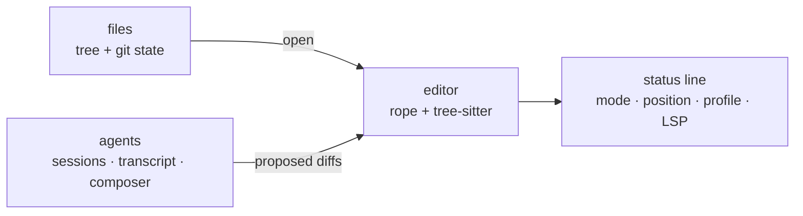

hangar &nbsp; Editor phase (P6)

The terminal UI is the primary interface, not the fallback. It is what runs over
an SSH session, inside tmux, on a machine with no GPU, and it is the reason the
daemon exists: close the laptop, reconnect, and the turn is still running.

## Layout

Panels are the same three in every UI — files, text, agents — because the mental
model should not change when you change cockpit.

The colours are not this crate's: every pane, card and status label is drawn from
the theme tokens the desktop app and the browser read, resolved from
`theme_tui` (over `theme`) in the project's settings. A theme is an extension, so
one pack recolours all three surfaces at once, and a project can choose a
different one without changing anything global. Saving the settings file is the
recolour: the client watches the user's and the project's `config.toml`, and the
status bar names the theme it switched to, so editing `theme_tui` in one window
is not a note to restart in another. The daemon's answer outranks that watch: the
profile-wide event stream opens with the preferences the daemon would apply and
sends a new set after every save, so a client attached to a daemon whose files it
cannot see — a remote host, a container — still follows `theme_tui`. The file
watch is the fallback for a client with no daemon, or a daemon too old to announce
them. `theme_follow_terminal = true` instead asks
the terminal for its own background and foreground when the client starts and
solves a palette around them, so the terminal UI can match the shell it was opened
in rather than the other way round; a terminal that will not answer keeps the named
theme.

## What it is built on

| Need | Choice |
| --- | --- |
| Rendering | `ratatui` + `crossterm` — immediate mode, the editor loop owns state |
| Text | `ropey` for the buffer, `tree-sitter` for highlighting |
| Agent terminals | a `vt100` grid drawn as styled lines, fed by the attach WebSocket |
| Transcript | markdown rendered to styled lines, not a browser |

<Aside type="note" title="Why not the obvious textarea widget">
Because a textarea is not an editor. Selection, folds, multiple cursors, and
diff review are the product; a widget that gets you a box with a cursor in it
gets you the first hour and costs you the second year.
</Aside>

## Non-negotiables

- **Keyboard only.** Every feature reachable without a mouse. This is not
  minimalism; it is what makes the TUI usable on a bad connection.
- **No blocking calls in the render loop.** Everything is a channel message.
- **60 fps or it is a bug.** The budget is 16 ms p95 from keystroke to paint, the
  same as the desktop app, measured in CI.
- **Same keymap data as the desktop and browser.** One `keymap.toml`, three
  consumers.

## Status

The crate is a working client: it lists the daemon's sessions, streams the open
session's transcript, answers a permission request with `y`, `a` or `n`, and starts
the daemon if nothing is listening (ADR 0004). `Ctrl-T` opens a terminal pane over
the shells an agent asked for — the same PTY the agent reads, typed into and resized
live, with the program's colours — asking which one when a session has several, and
`Ctrl-T` again leaves it without ending the program. The pane keeps ten thousand
lines behind its screen: `F2` reads back through them, `/` finds a string in that
history — case-insensitive until the query has a capital in it, landing on the
newest match before the cursor, with `n` and `N` to walk older and newer — and `v` and `y` copy a selection to the clipboard over OSC 52,
which is what makes a copy work over SSH. The transcript is a pane like the others —
`Tab` reaches it, or `F3` from anywhere — and answers to the same copy keys, so a
long answer is scrolled, searched and yanked with what the terminal already taught;
`?` lists those keys rather than the editor's while a pane is being read.

A menu bar across the top (`F9`) names every pane and the client's own commands as
rows, each row drawn with the chord that runs it from anywhere — a pane's own keys
are named in the pane, not in the bar — with **About** under Help: version, licence,
field manual, what built it and which daemon it is talking to. The underlined letter
in a title is the `Alt` chord that opens it, the way a menu bar has named its own
keys since before a terminal could report a mouse; the bar and its lists also answer
the mouse — click a title, slide along the bar to another, click a row to run it —
while a shell still gets `Alt` and a letter as the two bytes it has always meant.
`Ctrl-Left` and `Ctrl-Right` move the two dividers, and a mouse drag on either one
does the same thing, so the tree, the editor and the sidebar are the widths the
person reading them wants rather than the widths a constant guessed.

`acpilot tui --demo` draws the whole shell on a seeded world — files, editor, agent
sidebar, command palette, which-key hints and the stats bar — with no daemon and
nothing read from disk. Every command that is not built yet is tagged with the task
that would build it, so the screen is also the work list; `docs/notes/tui-shell.md`
is the layout and the decisions it is meant to settle. The desktop app renders the
same world when it gets its shell, so the two cannot drift apart. Editor panes,
inline diffs and the workspace picker are the editor phase (P6).
