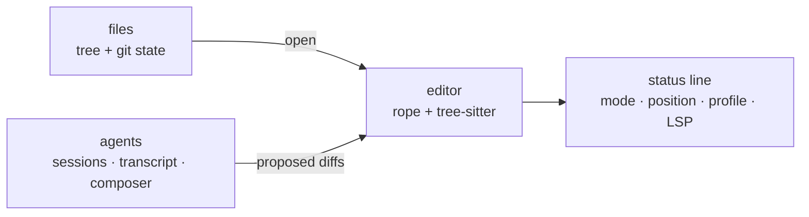

hangar &nbsp; Editor phase (P6)

The terminal UI is the primary interface, not the fallback. It is what runs over
an SSH session, inside tmux, on a machine with no GPU, and it is the reason the
daemon exists: close the laptop, reconnect, and the turn is still running.

## Layout

Panels are the same three in every UI — files, text, agents — because the mental
model should not change when you change cockpit.

## What it is built on

| Need | Choice |
| --- | --- |
| Rendering | `ratatui` + `crossterm` — immediate mode, the editor loop owns state |
| Text | `ropey` for the buffer, `tree-sitter` for highlighting |
| Agent terminals | `tui-term` over `vt100` grids |
| Transcript | markdown rendered to styled lines, not a browser |

<Aside type="note" title="Why not the obvious textarea widget">
Because a textarea is not an editor. Selection, folds, multiple cursors, and
diff review are the product; a widget that gets you a box with a cursor in it
gets you the first hour and costs you the second year.
</Aside>

## Non-negotiables

- **Keyboard only.** Every feature reachable without a mouse. This is not
  minimalism; it is what makes the TUI usable on a bad connection.
- **No blocking calls in the render loop.** Everything is a channel message.
- **60 fps or it is a bug.** The budget is 16 ms p95 from keystroke to paint, the
  same as the desktop app, measured in CI.
- **Same keymap data as the desktop and browser.** One `keymap.toml`, three
  consumers.

## Status

The crate exists and does nothing. The editor phase (P6) is where the editor becomes real; until
then there is no reason to pretend otherwise.
