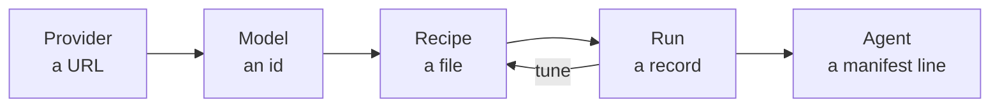

hangar &nbsp; Models phase (P4.5)

A **local model** is not an agent. It is an HTTP endpoint that continues text. It
has never heard of your repository, cannot open a file, and will cheerfully agree
to delete one.

The model lab is where you fix that. It is a workbench, not a chat window:

Each step is a thing you can look at, diff, and throw away:

| Step | What it is | Where it lives |
| --- | --- | --- |
| Provider | A chat endpoint, declared and probed by you | `config.toml` / `providers.toml` |
| Model | One model id the provider reported | Discovered, never invented |
| Recipe | Prompt, sampling, context budget, tool ceiling | `profiles/<name>/recipes/<id>.toml` |
| Run | One request and one answer, recorded | `profiles/<name>/runs.jsonl`, append-only |
| Agent | A recipe promoted into `agents.toml` | Spawned like any other ACP agent |

<Aside type="note" title="The autopilot is still the autopilot">
The point of the lab is not to make the model smarter. It is to make the model's
limits *visible* before it can touch your files. The lab shows which parameters
the server honours and how much window it really has. It also shows whether the
model can emit a tool call and how often that tool call parses.
</Aside>

## Why a lab instead of a settings pane

Because prompt tuning is an experiment. An experiment without a record is a
rumour. The lab keeps the four things you need to answer "why was it better
yesterday?":

- **The exact request.** System prompt hash, sampling values, resolved corpus
  files, and budget split. Replay re-sends it unchanged.
- **The exact answer.** Token usage, time to first token, stop reason, and any
  parameter the server refused, with the retry that omitted it.
- **The comparison.** Two runs side by side, with a delta in tokens and latency.
- **The verdict.** A promotion step that refuses to be quiet about weak
  tool-calling, and a manifest entry you can delete in one command.

## What this is not

- **Not a chat app.** There is no general-purpose assistant here. A recipe exists
  to become an agent, and the agent runs inside the permission broker.
- **Not a hosted service.** No model, no key, and no prompt leaves your machine
  unless you declare a provider that lives somewhere else.
- **Not a second brain for the editor.** The lab talks to the daemon API like
  every other surface. It holds no state of its own. There is one transcript, and
  it is the daemon's.

## What exists today

Providers, discovery, recipes, prompt assembly, the run log, the model API and the shim
agent (`acpilot-agent-lm`) are built and tested. A recipe is created over the API, a run
streams and appends its record, and a page of runs is served. The shim reads a recipe,
runs the model loop and reaches files, terminals and permissions only through ACP
callbacks. What is missing is the surface: the lab panes (P4.5-8) and the promotion
command that writes the manifest entry (P4.5-9). Until P4.5-9, the shim is started by
hand.

<Aside type="caution" title="Altitude check">
Pages in this section describe the models phase (P4.5). The [flight status](../status/) page
tells you whether it flies. This page tells you which runway we planned.
</Aside>
