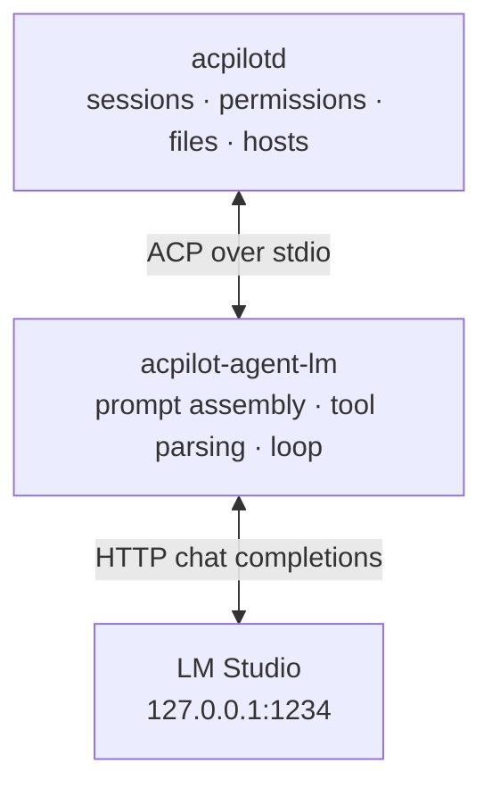

<span class="pill pill--hangar">hangar</span> &nbsp; Models phase (P4.5-5, P4.5-9)

<Aside type="note" title="Status">
The shim and promotion are built: `acpilot-agent-lm` runs a recipe and reaches the world
only through ACP callbacks (P4.5-5), and `POST /v1/recipes/{id}/promote` writes the
manifest entry below (P4.5-9). `acpilot agents rm` reverses it. The lab's promote key and
the web lab are still open.
</Aside>

Promotion is one request. It writes one manifest entry. That is the whole trick:

```bash
curl -X POST --unix-socket "$XDG_RUNTIME_DIR/acpilot/acpilot.sock" \
     http://localhost/v1/recipes/corpus-scraper/promote \
     -H 'content-type: application/json' \
     -d '{"agent_id": "corpus-scraper"}'
```

```toml
# ~/.config/acpilot/profiles/work/agents.toml
[[agents]]
# acpilot:promoted recipe="recipes/corpus-scraper.toml" mtime="2026-10-20T14:02:11Z"
id = "corpus-scraper"
name = "Corpus scraper (Qwen 7B)"
transport = "acp-stdio"
command = "acpilot-agent-lm"
args = ["--recipe", "corpus-scraper"]
restart = "on-crash"
env = { ACPILOT_RECIPE_PROFILE = "work" }
```

From that moment it is not a model. It is an agent like any other. `GET
/v1/agents` lists it. The TUI's session picker shows it. The transcript records
it. The permission broker guards it. `acpilot agents rm corpus-scraper` removes
it without a migration — and it removes only the line promotion wrote. An entry
with the same id that a person wrote by hand is refused rather than replaced.

## What actually happens in a turn

`acpilot-agent-lm` is a small ACP **agent** process. It owns the conversation
with the model. It owns nothing else:



The model never gets a file descriptor. It gets a tool *schema*. The shim turns
its tool calls into ACP client calls that the daemon may refuse:

| The model asks for | The shim calls | Who decides |
| --- | --- | --- |
| Read `docs/api.md` | `fs/read_text_file` | Policy: the policy allows reads inside the workspace by default |
| Write `src/routes.rs` | `fs/write_text_file` | Permission broker: diff shown, human or rule answers |
| Run `cargo test` | `terminal/create` | Policy: workspace root, command classification, audit |
| Anything else | `session/request_permission` | Strictest case by default |

So a local model inherits three things it would otherwise need its own
implementation of. It gets the **permission broker** and the **host abstraction**.
SSH and WSL come free because the daemon reads the file where it lives. It also
gets the **transcript** with its replayable sequence numbers.

<Aside type="note" title="Why a separate process and not a function call">
Because the alternative is a second ACP client inside the daemon. That client
would have its own tool schema and permission round-trip. It would also have its
own cancellation semantics. Two implementations of the same protocol is how an
editor ends up with two behaviours for "cancel". The one you tested is never the
one the user hit.
</Aside>

## The loop, and where it stops

Each turn has five steps. Assemble the prompt. Call the model. If the answer is a
tool call, execute it through ACP and append the result. Repeat.

Limits are explicit. A local model with a broken tool-call format will otherwise
loop until the context window catches fire:

- **`max_steps`** from the recipe (1–50). At the cap the turn stops with ACP's
  `max_turn_requests` and a notice carrying the number of steps. It does not hang or
truncate silently.
- **One repair attempt.** A tool call that does not parse gets one corrective
  message with the schema restated. A second failure becomes a visible notice and a
failed tool call. Pretending progress is worse than admitting the format.
- **Cancellation is immediate.** `session/cancel` aborts the HTTP stream rather
  than waiting for the next chunk. A 40-token-per-second model should not hold
  `Ctrl-C` hostage.
- **Overflow is an event.** Truncate, summarise, or refuse. The recipe says which,
  and the record carries the numbers either way.

## Promotion is honest about the odds

The route warns in its answer, before anybody starts the agent:

- The model did not call the tools probe. It can still answer questions, but
  nothing confirms it understands a tool schema, and the agent repairs a bad call
  once and then reports the failure rather than guessing an argument.
- The provider could not be asked at all: unreachable, disabled, or a credential
  the daemon cannot read. The entry is still written, with the reason attached.
- The recipe exposes `tools.search`, which the promoted agent does not offer: ACP
  has no workspace-search callback, so the agent says so instead of running a
  shell to fake it.

Two checks the design wanted are not measured yet: tool-call validity across the
last ten runs (the run log records model-only runs, which call no tools) and a
window larger than the host's memory (nothing reports host memory yet). They are
open in `TODO.md` rather than guessed at here.

Warnings do not block. A workbench that refuses to let you try is not a workbench.
But none of them are silent, and none of them hide in a log file.

## Reversing it

```bash
acpilot agents rm corpus-scraper      # removes the manifest entry
acpilot recipes rm corpus-scraper     # removes the recipe, if you want that too
```

Two files, two commands, no state to unwind. Acpilot never installed the model.
The transcript is a journal, not a dependency.
