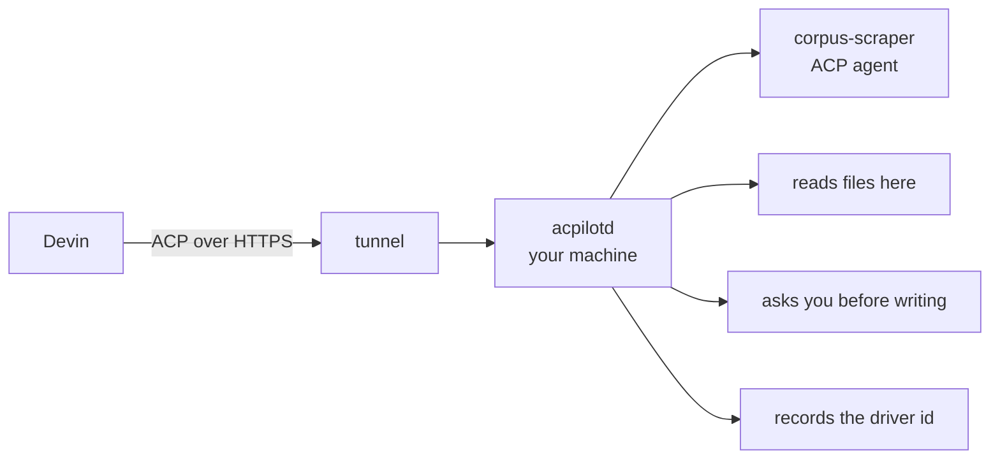

<span class="pill pill--hangar">hangar</span> &nbsp; Models phase (P4.5-10)

Acpilot is usually the ACP **client**: it spawns agents and answers their
callbacks. The bridge flips one seat. A remote driver connects to `acpilotd`,
opens a session on your machine, and prompts the agents that live here — while
the files, the terminals, and the permission broker stay exactly where they are.



Why bother: a cloud agent is good at planning and bad at having your repository.
The bridge gives it the repository without giving it the machine — it drives the
same session model the TUI does, over the same protocol, with the same broker in
the middle.

## Off until you say otherwise

The bridge is not listening by default. Enabling it is an explicit act with an
explicit bind address:

```toml
# ~/.config/acpilot/config.toml — global, because the socket belongs to the daemon
[acp.bridge]
enabled = true
bind = "127.0.0.1:7788"
require_token = true
profiles = ["work"]                                # which identities a driver may reach
# public_url = "https://acpilot.internal.example"   # what the driver dials
rate_limit_per_minute = 120
```

The bridge lives in the global config because the socket does — one daemon, one
listener. `profiles` is the identity fence: a driver paired against `work` gets
`404` for a `personal` session, exactly as another profile's client would.

Loopback may skip the token if you insist. Anything else may not — the daemon
refuses to start rather than exposing an unauthenticated agent endpoint because a
config file had a typo.

TLS is not terminated by the daemon in v0.1. Put it behind your tunnel or reverse
proxy; the docs say that out loud instead of implying a `https` that is not there.

## Token and pairing

Two secrets, because one is not enough for something this sharp:

```bash
acpilot acp token show          # prints the reference, not the token
acpilot acp token rotate        # writes a new 0600 file, argon2-hashed on disk
acpilot acp pair                # one-time code, 2 minutes, shown in the cockpit
```

| Readout | Value |
| --- | --- |
| bridge | `on` at `127.0.0.1:7788` |
| pairing | `ALFA-NINER`, expires in 1:42 |
| drivers | 0 connected, 1 known |

The token proves the endpoint is yours. The pairing code proves the driver is the
one you just walked through setup, not one that found the port.

## Handshake

ACP over HTTP with JSON-RPC bodies — the same messages a local agent sees, which
is the point: no bespoke "remote agent API" to document twice.

```json
{"jsonrpc":"2.0","id":1,"method":"initialize",
 "params":{"protocolVersion":1,
           "clientCapabilities":{"fs":{"readTextFile":true,"writeTextFile":true},
                                 "terminal":true},
           "clientInfo":{"name":"devin","version":"2.1"}}}

{"jsonrpc":"2.0","id":2,"method":"acpilot/pair",
 "params":{"code":"ALFA-NINER","name":"devin",
           "requested_scopes":["observe","prompt","cancel"]}}

{"jsonrpc":"2.0","id":3,"method":"session/new",
 "params":{"cwd":"/home/sam/code/api","mcpServers":[]}}

{"jsonrpc":"2.0","id":4,"method":"session/prompt",
 "params":{"sessionId":"s_01J…","prompt":[{"type":"text","text":"summarise the corpus"}]}}
```

`acpilot/pair` is the one method that is ours rather than ACP's. Everything after
it is ordinary ACP traffic.

## Scopes: type, do not sign

| Scope | Default | What it allows |
| --- | --- | --- |
| `observe` | granted | Read sessions, transcripts, workspace metadata |
| `prompt` | granted | Open sessions, send prompts |
| `cancel` | granted | Cancel a turn it started |
| `answer_permissions` | **not granted** | Answer permission requests |

The last one is the important one. Without it, a permission request raised by a
driver-started turn is routed to **your** attached clients — TUI, desktop, browser
— and the driver's `session/request_permission` call simply blocks. It gets a
`notice` update explaining that a human must answer, so it is never a mysterious
hang, and the transcript shows exactly which driver is waiting.

> We have clearance, Clarence. Roger, Roger. What's your vector, Victor?
>
> The tower clears. The passenger does not.

Granting `answer_permissions` is possible, per driver, and it is audited as a
distinct event because "the cloud agent approved its own write at 02:14" is a
sentence somebody may need to find later.

## What the daemon records

- Every session carries the driver id that opened it; `acpilot session show` prints
  `opened by: devin (d_01J…)`.
- Every grant, denial, prompt, and cancel appends to the audit log with the same
  identity.
- `GET /v1/acp/drivers` returns the connection panel's data — name, client version
  from `initialize`, peer, granted scopes, session count, prompt count, last seen.
- `acpilot acp revoke devin` disconnects it and makes its next call `401`. The
  record stays, because an audit trail that deletes itself is a suggestion.

<Aside type="caution" title="A remote driver is a person-shaped thing">
It has a token, a scope list, and a rate limit. If it asks for something outside
those, it gets a `403 permission_denied` with the missing scope named. If it asks
for a file outside the workspace, the answer is the same one your TUI would get:
no. The bridge changes who is typing, not what is allowed.
</Aside>

## Configuring the driver

Any ACP client can drive the bridge; it needs three values and nothing else:

| Value | From |
| --- | --- |
| Endpoint | `[acp.bridge] public_url`, or the bind address on a LAN |
| Token | `acpilot acp token rotate --print-once` |
| Pairing code | `acpilot acp pair`, valid for two minutes |

Devin's own configuration lives in Devin's documentation; Acpilot's side is the
three values above and a bridge that says `connected` when it worked. If you
would rather test with something smaller first, `acpilot acp echo` is a local ACP
client that pairs, opens a session, and prompts once — the smoke test before the
cloud gets a vote.
