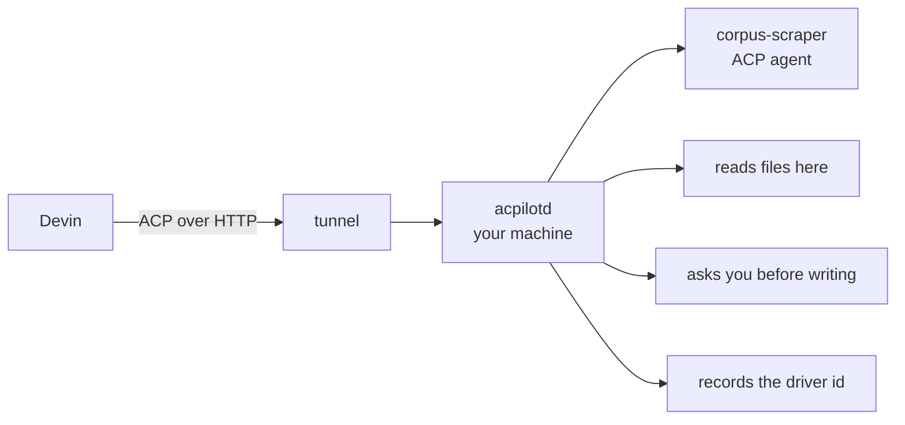

<span class="pill pill--hangar">hangar</span> &nbsp; Models phase (P4.5-10)

<Aside type="note" title="Status">
Both transports are built. `acpilotd --acp` serves ACP over stdin/stdout for one profile;
a pairing code and a driver token open the HTTP listener for a driver that is not in this
process. The remote half serves `POST /acp` (JSON-RPC), `GET /acp/events` (notifications) and
`POST /pair`, with the cockpit's pairing and revocation routes on the daemon's own listener.
There are no `acpilot acp ...` verbs yet: pairing and revocation are the HTTP routes.
</Aside>

Acpilot is usually the ACP **client**. It spawns agents and answers their
callbacks. The bridge flips one seat. A remote driver connects to `acpilotd`,
opens a session on your machine, and prompts the agents that live here. The
files, the terminals, and the permission broker stay exactly where they are.



A cloud agent is good at planning and bad at having your repository. The bridge
gives it the repository without giving it the machine. It drives the same session
model the TUI does, over the same protocol, with the same broker in the middle.

## Off until you say otherwise

The bridge is not listening by default. Enabling it is an explicit act with an
explicit bind address:

```toml
[acp.bridge]
enabled = true
bind = "127.0.0.1:7788"
# public_url = "https://acpilot.internal.example"   # what the driver dials
```

An `enabled` bridge with no `bind` is a startup error: nothing listens where it
was not told to. The daemon serves the listener on the profile it was started
with, and the cockpit routes are on the daemon's own listener.

The driver token is required even on loopback. The ticket allowed skipping it
there; this build does not offer that half-decision, because a listener that is
unauthenticated on one address is one config edit away from being unauthenticated
on another.

TLS is not terminated by the daemon in v0.1. Put it behind your tunnel or reverse
proxy. The docs say that out loud instead of implying an `https` that is not
there.

## Token and pairing

One secret is handed out, once, and kept only as a hash:

| Step | Who | What |
| --- | --- | --- |
| `POST /v1/acp/pairings` | the cockpit, with the daemon token | a code such as `ALFA-NINER`, single-use, two minutes |
| `POST /pair` | the driver, with the code | its row and a bearer token |
| `POST /acp` | the driver, with the token | JSON-RPC |

`POST /v1/acp/pairings` takes `{"grant_answer_permissions": false}` by default.
A driver cannot grant itself that scope by asking for it: the code was issued
with the person's answer, and the pair response says what it actually holds.

The ledger is the profile's `drivers.toml`, `0600`, and it holds an Argon2id hash
of each token rather than the token. A revoked driver's hash is cleared, so its
next request is `401`; the row stays, because an audit trail that deletes itself
is a suggestion.

## Handshake

ACP over HTTP with JSON-RPC bodies. These are the same messages a local agent
sees. That is the point: there is no bespoke "remote agent API" to document twice.

```json
{"jsonrpc":"2.0","id":1,"method":"initialize",
 "params":{"protocolVersion":1,
           "clientInfo":{"name":"devin","version":"2.1"}}}

{"jsonrpc":"2.0","id":3,"method":"session/new",
 "params":{"cwd":"/home/sam/code/api","mcpServers":[]}}

{"jsonrpc":"2.0","id":4,"method":"session/prompt",
 "params":{"sessionId":"s_01J…","prompt":[{"type":"text","text":"summarise the corpus"}]}}
```

While `session/prompt` is open, the turn's chunks arrive on `GET /acp/events` as
`session/update` notifications, in the schema ACP already defines. A driver that
never opens the stream still gets `end_turn` at the end; it reads the turn as one
silence.

A driver owns the sessions it opened. Another driver's `session/prompt`,
`session/cancel` and permission answer are refused rather than typed into a
conversation it did not start.

## Scopes: type, do not sign

| Scope | Default | What it allows |
| --- | --- | --- |
| `observe` | granted | Open sessions |
| `prompt` | granted | Send prompts |
| `cancel` | granted | Cancel a turn it started |
| `answer_permissions` | **not granted** | Answer permission requests |

The last one is the important one. Without it, a permission request raised by a
driver-started turn stays on the daemon's pending list — `GET /v1/permissions`,
and the TUI, desktop and browser that read it — and the person at the machine
answers. The driver's stream receives a `notice` explaining that a human must
answer, once per turn, so it is never a mysterious hang. The prompt stays open
until the person decides.

With the grant, the daemon sends the driver `session/request_permission` on its
event stream and accepts `session/answer_permission`. A driver that asks without
the grant is answered `-32003`, naming the missing scope.

> We have clearance, Clarence. Roger, Roger. What's your vector, Victor?
>
> The tower clears. The passenger does not.

"A cloud agent approved its own write at 02:14" is a sentence somebody may need to
find later, which is why the grant is a separate decision at pairing time.

## What the daemon records

- The driver row: name, the client name and version from `initialize`, granted
  scopes, session and prompt counts, and last seen. `GET /v1/acp/drivers` is the
  connection panel's data, revoked rows included.
- Which driver opened a session, so another driver cannot drive it. The store's
  session and audit rows do not carry the driver id yet; that is on P4.5-10's open
  list rather than implied by a column nobody writes.
- `POST /v1/acp/drivers/{id}/revoke` clears the hash and keeps the row.

<Aside type="caution" title="A remote driver is a person-shaped thing">
It has a token, a scope list, and a rate limit of 60 requests a minute. If it asks
for something outside its scopes, it is refused and the answer names the missing
scope. If it asks for a file outside the workspace, it gets the same answer your
TUI gets. That answer is no. The bridge changes who is typing, not what it allows.
</Aside>

## What a driver sees

The turn's assistant text and thoughts, tool calls with their patches, the plan,
mode changes and the daemon's notices. A patch carries only the fields the agent
changed, so a driver merges it into the row it already drew. Compaction and a
changed command list have no ACP update in this schema version, so they are
dropped rather than approximated.

## Configuring the driver

For the local transport a driver needs one value — the command line — and nothing
else:

```bash
acpilotd --acp --profile work --workspace /home/sam/code/api
```

For a remote driver, three:

| Value | From |
| --- | --- |
| Endpoint | `[acp.bridge] public_url`, or the bind address on a LAN |
| Pairing code | `POST /v1/acp/pairings`, shown by whatever cockpit is driving the daemon |
| Token | the `POST /pair` answer, kept by the driver |

Devin's own configuration lives in Devin's documentation. Acpilot's side is those
three values and a bridge that says `connected` when it worked.
