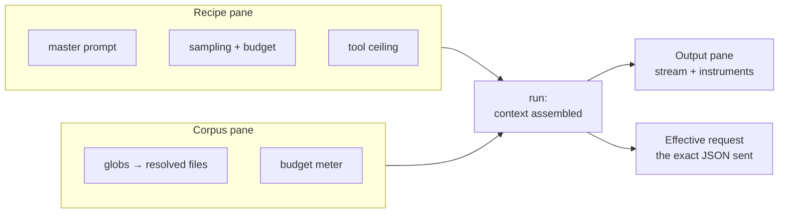

<span class="pill pill--hangar">hangar</span> &nbsp; Models phase (P4.5-8)

The lab is one screen with three panes and a strip of instruments. It is a client
of the daemon API. It uses the same recipes, runs and transcript as the CLI and
the browser. A run is the POST that streams it: closing the stream abandons the
run, and no record is written. A background run job is a design for P4.5-8, not a
claim about today.

<Aside type="note" title="Status">
No pane exists yet. `POST /v1/recipes/{id}/runs` streams a run and appends its
record, and `GET /v1/recipes/{id}/runs` pages them. The panes and the compare view
are P4.5-8; promotion is P4.5-9.
</Aside>



## The recipe pane

The **master prompt** is a real editor, not a textarea. It has the same buffer,
undo grouping, and search as the main editor. The prompt is the artefact you
will edit most, and copying it into a web form would be a downgrade.

Every knob shows its value, its source, and its effect. `max_tokens: (server)`
means the recipe does not set it. It does not mean zero. `window: server
(32,768)` means the provider reported the number. If the provider did not report
one, the field is empty and says **unknown**. The recipe must supply a value
before the lab accepts a run.

<Aside type="note" title="A knob that does nothing is worse than no knob">
Some servers accept `top_k` and ignore it. Some reject it outright. Some honour
it only on certain models. Acpilot cannot see inside the sampler, so it does not
pretend to. When a server rejects an optional parameter, the client retries
without it. The run record names it under **refused parameters**. That list is
more useful than another slider, and it is honest about what it can know.
</Aside>

## The corpus pane

Corpus is how the model sees your project: globs, not pasted text.

```toml
[[corpus]]
glob = "docs/**/*.md"
max_files = 200
max_bytes = 65536
```

The pane resolves the globs against the **workspace root**, on the host where the
workspace lives. A remote workspace therefore reads remote files. The pane shows
the exact file list with sizes and a running budget meter. Ignore rules apply,
the loader skips binary files, and the order is stable. Two runs of the same
recipe on the same commit are the same request.

Resolution happens *before* the run. That is the point. "It worked yesterday"
usually means a corpus that grew by a changelog file.

## The output pane

Streaming text, and a strip of instruments that shows only measured values:

| Gauge | Shown when | Notes |
| --- | --- | --- |
| Time to first token | The provider reports it | The number that tells you the model loaded |
| Tokens / second | The provider reports it | LM Studio's `stats`. Absent on plain OpenAI-shaped servers |
| Tokens used | Always | Marked **estimated** until the server's `usage` arrives |
| Stop reason | Always | `eosFound`, `maxPredictedTokensReached`, or our own step cap |
| Warnings | When non-empty | Refused parameters, truncated corpus, repaired tool call |

<Aside type="caution" title="Estimated is a different colour on purpose">
Pre-flight counts use a bytes/4 heuristic with a documented error band. When the
answer comes back with `usage`, the daemon reconciles the run record and the flag
flips. The UI does not quietly swap one for the other. A number you cannot trust is
styled like a number you cannot trust. That is the whole etiquette of an
instrument panel.
</Aside>

## The stats bar

Above the instruments, one row per **integration** answers two questions. For a
provider in the lab or an agent in the cockpit, it shows how much window is gone
and how much credit is left.

```text
lmstudio   ctx  ████████░░░░░░░░░░░░   12.3k / 32.8k    credits  —
openrouter ctx  ██░░░░░░░░░░░░░░░░░░    8.1k / 128k     credits  ███░░░░░░  24 / 80
claude     ctx  ██████████████░░░░░░   98.0k / 140k     credits  █████░░░░  45 / 100
```

Both bars come from the same `IntegrationStats` document. The context bar needs
a reported `used` and `window`. The credit bar needs `used` and `limit`, or a
`remaining` beside a known ceiling. When those are absent, the track is drawn
indeterminate: not empty, not full. A bar that fills from a guess is worse than a
bar that admits it does not know.

| Figure | Source | Shown as |
| --- | --- | --- |
| Context used | Provider `usage`, or the session transcript | `server` or `estimated` |
| Context window | Provider metadata, or the recipe | `server` or `configured`, never defaulted |
| Credits spent / left | Provider balance endpoint, or a plan in the profile | `server` or `configured` |
| Anything else | Nobody | `unknown`, indeterminate track |

Local servers are the normal case for a missing credit bar. LM Studio and Ollama
do not bill, so there is nothing to show and the UI invents no zero. A hosted
provider that exposes a balance, such as OpenRouter's `/api/v1/credits`, reports
it on the same probe that refreshes the model list. The row's `updated_at` says
when.

Agents follow the same rule with a different source. Usage reported by the
agent's protocol is `server`. A transcript counted by the daemon is `estimated`.
An agent that reports neither still gets a row whose track is indeterminate. The
daemon never removes the row for being quiet. A bar that reflows when a provider stops
answering teaches you to distrust it.

## The effective-request inspector

A debug drawer shows the exact JSON body it sent: messages, sampling
parameters, tool schemas, and the model id. It also shows anything the adapter
added or dropped on the way.

Most local-model debugging is answering "did the server get what I think I sent?"
with evidence rather than opinion. This drawer is that evidence. It is one
keystroke from the transcript, so you can paste it into a bug report that gets
solved.

## Compare mode

Two runs, side by side: token delta, latency delta, stop reason, and a diff of the
answers. Runs are immutable records, so comparison never re-rolls the dice. If you
want a new sample, that is a new run, clearly labelled.

Promotion is designed to live here, one keystroke away. It warns first:

```text
promote recipe "corpus-scraper" as agent "corpus-scraper"?
  ⚠ tool calls parsed in 7 of 10 runs (70%)
  ⚠ this model has never passed the tools probe
  ✓ window 32,768, reported by the server
```

## Keyboard first

Every pane is reachable without a mouse. The prompt editor keeps the keymap you
set globally. No gauge is the only way to learn something: `acpilot runs show
<id> --json` returns the same record the pane is drawing. A workbench that you can
only operate by pointing at it is a kiosk.
