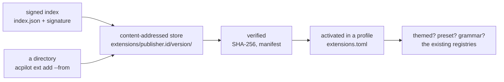

hangar &nbsp; P4.6

An **extension** is a modification approved for one airframe at a time. It is a
directory with a manifest and some assets: a theme, a set of language-server
presets, an agent preset, a grammar, snippets, a keymap layer. Installing it puts
files on disk. Turning it on is a separate, per-profile decision.

That split is the whole design. Two profiles can share one downloaded theme
without sharing one client's agent presets, and `profile diff` can still explain
where a value came from.

## Two tiers, and only one of them is here

| Tier | What it can contain | Ships |
| --- | --- | --- |
| **Declarative** | Theme tokens, LSP and agent presets, tree-sitter grammars with queries, snippets, keymap layers | v0.1 |
| **Code** | Transcript parsers, tokenizers, anything needing a runtime | proposed, not v0.1 |

The line is drawn at "does this need to *do* something while you type". A theme is
data. A preset is data. A grammar is a compiled `.wasm` parser driven by the same
tree-sitter runtime the editor already embeds — narrower than a plugin API, not
the same as inert, and [the registry page](registry/) says so out loud.

Code extensions would mean a WASM runtime, an ABI, a capability model, and a
memory budget: a project, not a checkbox. That is why P4.6 ships the tier that
answers most requests and leaves the other one honest on the roadmap.

<Aside type="note" title="Form 337, but faster">
An aviation modification needs a supplemental type certificate: the change is
described, reviewed, and approved *for that airframe*. An extension is the same
idea with a checksum — reviewed in the index, pinned on install, and approved per
profile rather than for the whole hangar.
</Aside>

## What an extension may not do

- **Grant itself permissions.** A preset that names a terminal tool still meets the
  broker, and a command it introduces is trust-pinned on first run exactly like a
  hand-written one.
- **Run at install time.** Installing unpacks a directory and hashes it.
- **Reach the network.** Tier 1 has no runtime to reach it with.
- **Shadow a built-in.** Ids are `publisher.id`; a collision is an error, not an
  override, because a theme that silently replaced `night-flight` would make every
  screenshot in this manual a lie.

## Not a plugin system

Plugins run inside the product and need a host API, a versioning policy, and a
way to break every release. Extensions here contribute **data to existing
registries** — the same `lsp.toml`, `agents.toml`, and theme tokens the product
already reads. When a new kind of contribution is needed, the registry gets a new
type; the extension format does not grow an API.

## What is built today

The contract (this page and its neighbours), the OpenAPI types, the ADR, and the
loader. `crates/acpilot-extensions` parses and validates manifests, refuses paths
that leave the extension directory, and resolves theme inheritance and
collisions. The four built-ins in `extensions/` — two themes, ten language-server
presets, four agent presets — are embedded in the binary and load through that
same code, so the schema is tested by the things we already ship before anyone
else's file is trusted.

Installing is a checksummed, atomic store; a version whose bytes change is
`Blocked` and invisible to every loader. Activation is a per-profile list with
three layers of precedence and `acpilot ext why` naming the winner and everything
it overrode. The [marketplace](marketplace/) is a curated list of repositories
in this repository, changed by pull request. The signed index and download URLs
are P4.6-4.
