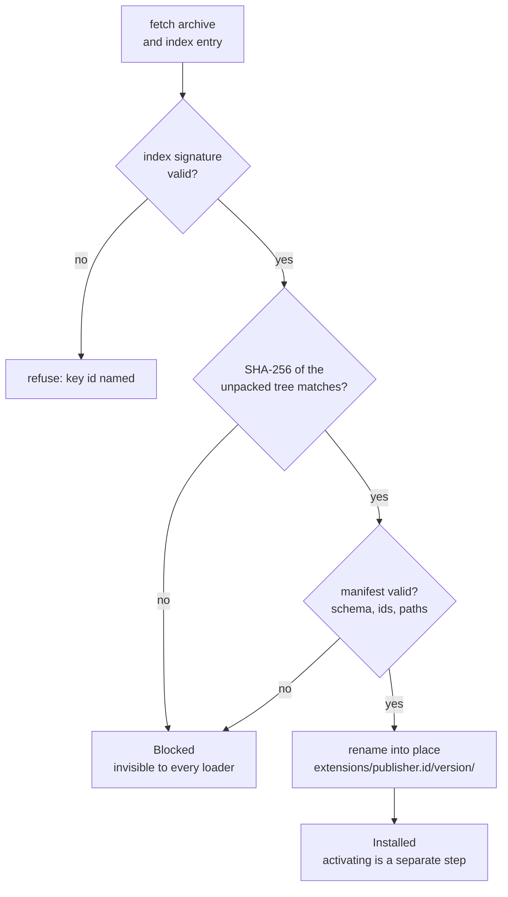

<span class="pill pill--hangar">hangar</span> &nbsp; P4.6-3, P4.6-4, P4.6-5

Two verbs, deliberately separate:

```bash
acpilot ext add acpilot.rust-pack        # install: download, verify, unpack
acpilot ext activate acpilot.rust-pack   # approve: this profile may use it
```

Installing changes the disk. Activating changes what one profile's loaders see.
Neither touches your `config.toml`, `agents.toml`, or `lsp.toml` — which is why
`acpilot profile diff work personal` can still explain every value afterwards.

## The index

The registry is a static document, not a service:

```json
{
  "schema_version": 1,
  "generated_at": "2026-10-20T14:02:11Z",
  "extensions": [
    {
      "id": "acpilot.rust-pack",
      "version": "1.2.0",
      "kinds": ["language_servers", "theme", "snippets"],
      "publisher": "acpilot",
      "checksum": "sha256:9f2c…",
      "size": 184320,
      "min_acpilot": "0.1.0",
      "download": "https://…/rust-pack-1.2.0.tar.gz"
    }
  ]
}
```

plus a detached signature over the canonical JSON. The maintainer's public key
ships in the binary; `registry.trusted_keys` adds a key for a private index, and a
signature that does not verify is a hard failure with the key id in the message.

<Aside type="note" title="Reviewed, not crawled">
Publishing means a pull request against the index repository: a human reads the
manifest, the diff of the assets, and the checksum. Slow, and the only
supply-chain defence that has ever worked at this scale. A private registry only
needs `acpilot ext add --index https://…/index.json`.
</Aside>

## What happens on install



Extraction goes to a temporary directory first: a half-written extension is never
visible, and an interrupted download leaves nothing to clean up but the temp path.

## Approval is per profile

```toml
# ~/.config/acpilot/profiles/work/extensions.toml
schema_version = 1
active = ["acpilot.rust-pack", "acpilot.night-flight-syntax"]
```

Precedence, lowest to highest:


`acpilot ext why rust-analyzer` prints that chain for one preset, reusing the same
origin machinery as `profile diff`:

```text
rust-analyzer
  command      rust-analyzer
  args         ["--log-file", "/tmp/ra.log"]
  from         acpilot.rust-pack 1.2.0  (extensions.toml, work profile)
  overridden   built-in preset, 2024 edition defaults
```

## Failure modes, and what they look like

| Situation | What happens |
| --- | --- |
| Index signature invalid | Install refused, key id named, nothing written |
| Checksum mismatch | Extension marked `Blocked`, never activated, `ext verify --all` reports it by name |
| Manifest invalid | Same, with the parse error and the field |
| `min_acpilot` too new | Refused, both versions shown |
| Active but missing | Profile stays usable; every UI shows a missing-extension notice naming it |
| Deactivated mid-session | Loaders re-read, `extension.changed` fires, no restart |

<Aside type="caution" title="A grammar is compiled code">
A `.wasm` tree-sitter grammar executes inside the parser runtime. It is a much
smaller surface than a plugin API — it cannot open files, spawn processes, or
speak to the network through the host — but it is not inert, and this page will
never claim otherwise. The review and the pinned checksum are the defence.
</Aside>

## Updates are a decision, not a schedule

There is no auto-update and no fetch on startup. `acpilot ext update` lists what
changed, and a version only arrives when a person types the command:

```bash
acpilot ext update --check
acpilot ext update acpilot.rust-pack     # new checksum, new review, your call
```

An editor that quietly changes your theme because a publisher pushed 1.2.1 at
midnight is an editor you cannot reproduce a bug in.
