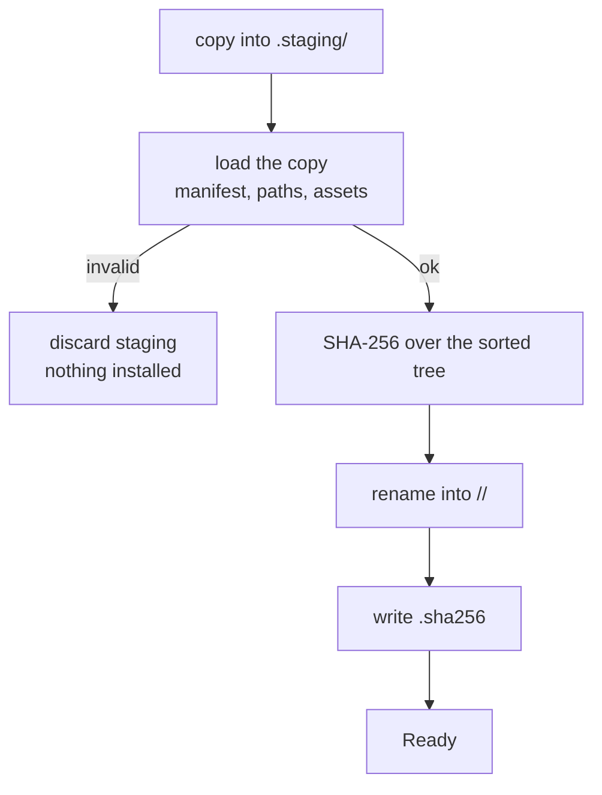

<span class="pill pill--boarding">boarding</span> &nbsp; tasks P4.6-3 and P4.6-5 landed; the signed index is task P4.6-4

Two verbs, deliberately separate:

```bash
acpilot ext add --from ~/src/acpilot-pack   # install: copy, verify, record
acpilot ext activate acpilot.rust-pack      # approve: this profile may use it
```

Installing changes the disk. Activating changes what one profile's loaders see.
Neither touches your `config.toml`, `agents.toml`, or `lsp.toml` — which is why
`acpilot profile diff work personal` can still explain every value afterwards.

## The store

```text
~/.local/share/acpilot/extensions/
  acpilot.paper/
    1.0.0/                 # the extension, exactly as installed
    1.0.0.sha256           # sha256:<64 hex characters>
```

Install is atomic and ordered so that nothing unverified is ever visible:



The hash covers a canonical stream: a format tag, then every file sorted by path,
each as a length-prefixed path followed by length-prefixed contents. It does not
depend on directory order, and a file whose contents look like a path cannot be
confused with a path. Symlinks and non-UTF-8 names are refused rather than hashed
differently on different hosts.

## Blocked means invisible

A version whose bytes do not match its record is `Blocked`. Not warned about,
not loaded with a caveat: every loader — `ext why`, the registries, the daemon's
future routes — treats it as if it were not installed, and `acpilot ext verify
--all` names it and prints both checksums.

```bash
$ acpilot ext verify --all
ok      acpilot.paper@1.0.0
blocked acpilot.pack@1.0.0: checksum mismatch: recorded sha256:9f2c…, computed sha256:41aa…
1 of 2 versions blocked
$ echo $?
1
```

| Situation | Result |
| --- | --- |
| Bytes changed | `Blocked`, mismatch printed |
| Record missing | `Blocked`, "not installed by the store" |
| Record malformed | `Blocked`, the format is named |
| Hash matches but manifest is broken | `Blocked`, the parse error is named |
| Directory named like a version but isn't | `Blocked`, the path is named |

Activating a blocked extension is refused as well. Approval is a statement about
known bytes, and there are no known bytes to approve.

## Approval is per profile

```toml
# ~/.config/acpilot/profiles/work/extensions.toml
schema_version = 1
active = ["acpilot.rust-pack", "you.hangar"]
```

Precedence, lowest to highest:


Within one layer, two things claiming the same id is an error — two activated
packs that both ship `rust-analyzer` is a bug in one of them. Across layers the
higher layer wins, and the chain is recorded:

```bash
$ acpilot ext why rust-analyzer --profile work
language server rust-analyzer
  command     profile-analyzer
  args        ["--log-file", "/tmp/ra.log"]
  languages   rust
  from        profile lsp.toml   (wins)
  overridden  extension acpilot.rust-pack 1.2.0
  overridden  built-in acpilot.language-servers 1.0.0
```

Themes are not presets: an id is an identity, so no layer can replace
`acpilot.night-flight` and make every screenshot in this manual a lie. An
activated theme may `extends` a built-in and inherit its unset tokens.

Deactivating is a file edit, and every resolution re-reads the file: there is no
cached registry to invalidate, so the next answer is the correct one. The daemon
event that tells attached UIs to re-read (`extension.changed`) is the mod-shop phase's task P4.6-10.

## Pruning

`acpilot ext prune` removes versions no profile activates — with a floor: it never
removes the newest version of an id, because a store where nothing has been
activated yet should not lose a fresh install.

```bash
$ acpilot ext prune --dry-run
would remove acpilot.rust-pack@1.1.0
$ acpilot ext prune
removed acpilot.rust-pack@1.1.0
```

## What is still missing

The signed static index (mod shop phase, task P4.6-4) with per-version download URLs and a signature
over the list. Until then the marketplace is the
[curated list](../marketplace/) in this repository, and installing means checking
a repository out and pointing `ext add --from` at it — same verification, one
manual step.
