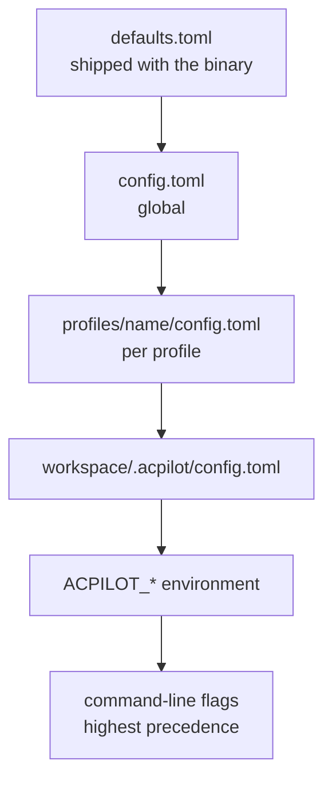

<span class="pill pill--hangar">hangar</span> &nbsp; Profiles phase (P4) &nbsp;·&nbsp; this shape may still change

Configuration is layered, and every layer can override a single key rather than a
whole file. The last word wins:



## Where things live

| Platform | Config | Data | Runtime |
| --- | --- | --- | --- |
| Linux | `~/.config/acpilot` | `~/.local/share/acpilot` | `$XDG_RUNTIME_DIR/acpilot/acpilot.sock` |
| macOS | `~/Library/Application Support/acpilot` | same | `$TMPDIR/acpilot/acpilot.sock` when `XDG_RUNTIME_DIR` is unset |
| Windows | `%APPDATA%\acpilot` | `%LOCALAPPDATA%\acpilot` | loopback `127.0.0.1:7777` today; `\\.\pipe\acpilot-$USER` is P10-5 |

The runtime directory holds the socket, the spawn lock and the daemon's log, and
it is `0700` because the socket is `0600`: the filesystem, not a token, is what
keeps another local user off the API. `acpilotd --addr <host:port>` binds TCP
instead, which is opt-in precisely because a port has no such boundary.

Only `acpilot-profile` is allowed to call `directories`. Every other crate
resolves mutable paths through it, so "where does this file go" has exactly one
answer.

## Global config

```toml
# ~/.config/acpilot/config.toml
schema_version = 1
active_profile = "work"

[daemon]
addr = "127.0.0.1:7777"
log = "info"

[editor]
tab_width = 2
insert_spaces = true
format_on_save = true
wrap = false
theme = "acpilot.night-flight"
```

## Project config

A project is a directory holding `.acpilot/config.toml`. That file is the only
marker, and it exists only because someone saved settings there — opening a
directory or a file never creates one.

```toml
# <project>/.acpilot/config.toml
schema_version = 1
profile = "work"                    # which profile this project runs under

[preferences]
tab_width = 2
```

Settings are merged per key, in this order: the built-in defaults
(`acpilot-profile/defaults.toml`), then `~/.config/acpilot/config.toml`, then the
project's `.acpilot/config.toml`. A key nobody sets keeps the default; a project
file that sets one key changes one key.

A path names the project: `acpilot tui src/main.rs` and `acpilot-gui src/main.rs`
climb from the file to the nearest `.acpilot/config.toml`, while a directory is
used as given. A file with no project above it is a **temporary project** — the
file's own directory, with the user's settings and the defaults and nothing written
to disk. That is what makes `acpilot notes.md` a text editor rather than a
setup wizard.

## Profile config

```toml
# ~/.config/acpilot/profiles/work/config.toml
schema_version = 1

[policy]
default = "ask"                       # allow | ask | deny
outside_workspace = "deny"

[lsp.rust]
command = "rust-analyzer"
args = []
```

## Providers and recipes

A model server is declared per profile, next to the agents that may use it. It is
inert until `enabled = true` *and* something asks it a question — there is no
startup scan.

```toml
# ~/.config/acpilot/profiles/work/providers.toml
schema_version = 1

[[providers]]
id = "lmstudio"
kind = "lm_studio"                 # or "open_ai_compatible"
label = "LM Studio (this machine)"
base_url = "http://127.0.0.1:1234"
enabled = true
# credential_ref = "keyring:work/lmstudio"
```

Recipes live one directory over, one file per model-plus-prompt:

```text
profiles/work/
  config.toml
  providers.toml
  agents.toml
  extensions.toml                  # activated extensions (install is global)
  recipes/corpus-scraper.toml      # see Flight test → Recipes
```

## The ACP bridge

Global, because it is a listener rather than an identity. Off unless enabled, and
`profiles` is the fence around what a paired remote driver can reach.

```toml
# ~/.config/acpilot/config.toml
[acp.bridge]
enabled = false                    # the default, and the recommendation
bind = "127.0.0.1:7788"
require_token = true
profiles = ["work"]
rate_limit_per_minute = 120
```

<Aside type="note" title="One socket, one identity list">
Binding a second port per profile would be the obvious alternative and the wrong
one: it multiplies listeners, certificates, and firewall rules. One endpoint,
an explicit profile allowlist, and a `404` for anything outside it — the same
answer a local client gets.
</Aside>

<Aside type="note" title="Unknown keys are an error, not a shrug">
A typo in a config file should be loud. `acpilot doctor` lists every unknown key
with the file and line that produced it, and the daemon refuses to start with a
config it cannot fully understand — a setting that silently does nothing is worse
than no setting.
</Aside>

## Precedence, not guessing

```bash
acpilot profile diff work personal
```

Prints the effective configuration with the winning file for each key. When the
answer to "why is it doing that?" is a config file three layers deep, this is the
command that ends the argument.

## Environment variables

| Variable | Effect |
| --- | --- |
| `ACPILOT_PROFILE` | Selects the profile (after `--profile`, before the marker file) |
| `ACPILOT_ADDR` | Daemon bind address (used by `acpilotd` today) |
| `ACPILOT_LOG` | `tracing` filter override |
| `RUST_LOG` | Fallback for `ACPILOT_LOG` |
| `ACPILOT_BRIDGE_TOKEN` | Read once at startup for the ACP bridge when `require_token` is set and the keyring is unavailable (containers). Never echoed by `doctor`. |

Secrets are never read from the environment for a profile — see
[Secrets](../../safety/secrets/).
