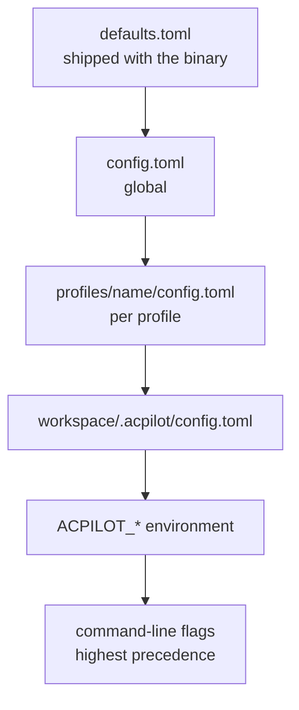

<span class="pill pill--hangar">hangar</span> &nbsp; Profiles phase (P4) &nbsp;·&nbsp; this shape may still change

Configuration is layered, and every layer can override a single key rather than a
whole file. The last word wins:



## Where things live

| Platform | Config | Data | Runtime |
| --- | --- | --- | --- |
| Linux | `~/.config/acpilot` | `~/.local/share/acpilot` | `$XDG_RUNTIME_DIR/acpilot/acpilot.sock` |
| macOS | `~/Library/Application Support/acpilot` | same | `$TMPDIR/acpilot/acpilot.sock` when `XDG_RUNTIME_DIR` is unset |
| Windows | `%APPDATA%\acpilot` | `%LOCALAPPDATA%\acpilot` | loopback `127.0.0.1:7777` today; `\\.\pipe\acpilot-$USER` is P10-5 |

The runtime directory holds the socket, the spawn lock and the daemon's log, and
it is `0700` because the socket is `0600`: the filesystem, not a token, is what
keeps another local user off the API. `acpilotd --addr <host:port>` binds TCP
instead, which is opt-in precisely because a port has no such boundary.

Only `acpilot-profile` is allowed to call `directories`. Every other crate
resolves mutable paths through it, so "where does this file go" has exactly one
answer.

## Global config

```toml
# ~/.config/acpilot/config.toml
schema_version = 1
active_profile = "work"             # used when no flag, environment or project marker names one

[preferences]
tab_width = 2
insert_spaces = true
format_on_save = true
trim_trailing_whitespace = true
wrap = false
rulers = [80, 100]                 # cell columns; empty or absent draws none
theme = "acpilot.night-flight"
# theme_follow_terminal = true      # solve the terminal's palette from the terminal itself
tree_respect_gitignore = true     # the file tree hides what the workspace's .gitignore hides
diagnostics_min_severity = "warning"
```

`format_on_save` asks the daemon's language server for edits before the write; a
file whose language has no server, or whose server is not installed, is saved
unchanged rather than treated as a failed save. `wrap` and `rulers` are applied by
the TUI and the browser editor, and a `PATCH` to the preferences route writes only
the fields it names into the profile's `profile.toml`.

The daemon reads its own flags and `ACPILOT_ADDR` today; a `[daemon]` table in
this file is the profiles phase's (P4) and is not read yet.

### Themes

A theme is an extension, and the same one draws the terminal UI, the desktop app
and the browser the daemon serves: one set of tokens, so "muted text" cannot mean
three greys. `theme` is the answer for every surface that does not name its own;
set a per-surface key only when one of them should differ — a light window beside
a dark terminal is a preference, not a mistake.

```toml
[preferences]
theme = "acpilot.night-flight"      # every surface
# theme_tui = "acpilot.paper"       # just the terminal
# theme_gui = "acpilot.paper"       # just the desktop app
# theme_web = "acpilot.paper"       # just the browser page
```

Any theme a loaded extension provides works here. A project's
`.acpilot/config.toml` may override any of the four keys on its own, so a client
repository can be light while everything else stays night flight. An id that no
loaded extension provides is refused by name rather than drawn in default
colours.

`theme_follow_terminal` replaces the terminal's id with the terminal itself: the
client asks what its background and foreground are (`OSC 11` and `OSC 10`) and
solves a complete token set around that pair, so a black terminal and a cream one
both get a theme that fits. The desktop app and the browser are not affected —
neither has a terminal to ask. A terminal that will not say falls back to the
theme named above, which is why the key is safe to turn on anywhere.

Saving the file applies it. `acpilot tui` watches the user's and the project's
settings and recolours itself when either changes, naming the theme in its status
bar; the daemon resolves `theme_web` per request, so the browser page is the new
palette on its next load. A file that does not parse, or that names a theme no
loaded extension provides, leaves the running client on the colours it already
has — a half-written file is not a reason to go blank — and the next save is read
normally.

### The file tree

`tree_respect_gitignore` decides whether the files pane shows the working tree or
the project. On, a path a `.gitignore` names is not a row: no `target/`, no build
output, no editor droppings, and no `.git` directory either — git never lists its
own bookkeeping, so the tree does not either. Nested `.gitignore` files are read
where they are, so a vendored directory's own rules apply to it and stop there.

Off, the tree is the directory: everything on disk, which is what you want when
the thing you are looking for is a build artefact.

The daemon answers the listing and does the matching, not the client, so every
client shows the same tree and a remote workspace's ignore files are read on the
machine that has them. `.git/info/exclude` and the global excludes file are not
read: those are per-machine, and two people looking at one repository should see
the same tree. Changing the setting is picked up by the next listing — `Ctrl-R` in
the files pane, in the terminal UI.

The tree also has a key for the other answer, so looking at a build directory once
does not mean editing a setting and remembering to change it back: `H` in the files
pane asks the daemon for the same directories with the hidden rows marked, draws
them greyed and italic, and keeps every directory that was open open. `H` again
puts the tree back. `/` in the same pane searches the whole workspace by path, and
it follows this setting too: on, a find cannot return what the tree hides.

## Project config

A project is a directory holding `.acpilot/config.toml`. That file is the only
marker, and it exists only because someone saved settings there — opening a
directory or a file never creates one.

A launch resolves its profile in one order: `--profile`, then `ACPILOT_PROFILE`,
then the `profile` key below, then `active_profile` in the global file, then
`default`. A missing name is exit `3` with `acpilot profile new <name>`, never a
fallback; guessing is how a work prompt goes out under a personal key. Only the
last fallback creates `default` (a directory with `schema_version = 1`) on first
use.

```toml
# <project>/.acpilot/config.toml
schema_version = 1
profile = "work"                    # which profile this project runs under

[preferences]
tab_width = 2
```

Settings are merged per key, in this order: the built-in defaults
(`acpilot-profile/defaults.toml`), then `~/.config/acpilot/config.toml`, then the
profile's `config.toml` and `profile.toml` (a parent's beneath a child's when the
registry says `extends`), then the project's `.acpilot/config.toml`, then
`ACPILOT_*` variables, then command-line flags. A key nobody sets keeps the
default; a project file that sets one key changes one key.

Arrays replace, except `disabled` and `deny`, which union: a workspace adding one
disabled agent must not silently re-enable the ones the profile disabled.
`extends` walks at most four profiles and refuses a cycle. An unknown key is
warned about once and the read continues, so a newer file still runs on an older
binary; a value of the wrong type fails with the file, line and key. A running
client follows the settings: the daemon watches every file in the cascade,
including a parent profile's, and sends the whole preferences object after a
save, so a theme or an editor preference applies without a restart. A save that
does not parse keeps the last good settings and is reported instead of applied.

A path names the project: `acpilot tui src/main.rs` and `acpilot-gui src/main.rs`
climb from the file to the nearest `.acpilot/config.toml`, while a directory is
used as given. A file with no project above it is a **temporary project** — the
file's own directory, with the user's settings and the defaults and nothing written
to disk. That is what makes `acpilot notes.md` a text editor rather than a
setup wizard.

## Profile config

`config.toml` keeps the profile's policy and language servers. Preferences live
in `profile.toml` beside it; both are layers of the same cascade, and a profile
written before `profile.toml` existed keeps working.

```toml
# ~/.config/acpilot/profiles/work/config.toml
schema_version = 1

[policy]
default = "ask"                       # allow | ask | deny
outside_workspace = "deny"

[lsp.rust]
command = "rust-analyzer"
args = []
```

```toml
# ~/.config/acpilot/profiles/work/profile.toml
[preferences]
tab_width = 2
theme = "acpilot.paper"
```

## Providers and recipes

A model server is declared per profile, next to the agents that may use it. It is
inert until `enabled = true` *and* something asks it a question — there is no
startup scan.

```toml
# ~/.config/acpilot/profiles/work/providers.toml
schema_version = 1

[[providers]]
id = "lmstudio"
kind = "lm_studio"                 # or "open_ai_compatible"
label = "LM Studio (this machine)"
base_url = "http://127.0.0.1:1234"
enabled = true
# credential_ref = "keyring:work/lmstudio"
```

Recipes live one directory over, one file per model-plus-prompt:

```text
profiles/work/
  config.toml
  providers.toml
  agents.toml                    # optional: no file means no agents
  extensions.toml                  # activated extensions (install is global)
  recipes/corpus-scraper.toml      # see Flight test → Recipes
```

## The ACP bridge

Global, because it is a listener rather than an identity. Off unless enabled, and
`profiles` is the fence around what a paired remote driver can reach.

```toml
# ~/.config/acpilot/config.toml
[acp.bridge]
enabled = false                    # the default, and the recommendation
bind = "127.0.0.1:7788"
require_token = true
profiles = ["work"]
rate_limit_per_minute = 120
```

<Aside type="note" title="One socket, one identity list">
Binding a second port per profile would be the obvious alternative and the wrong
one: it multiplies listeners, certificates, and firewall rules. One endpoint,
an explicit profile allowlist, and a `404` for anything outside it — the same
answer a local client gets.
</Aside>

<Aside type="note" title="Unknown keys are loud, but not fatal">
A typo should not be silent. The cascade warns once per unknown key and names the
file that wrote it, then keeps running, because a file written by a newer binary
must still work on an older one. A value of the wrong type is different: it fails
with the file, line and key, since running on a subset of what someone wrote is
the setting that silently does nothing.
</Aside>

## Precedence, not guessing

```bash
acpilot config explain tab_width
acpilot config explain preferences.theme --profile work
```

Prints the winning value and the file, environment variable or flag that wrote
it. A bare key is a preference, so `tab_width` and `preferences.tab_width` name
the same value. When the answer to "why is it doing that?" is a config file three
layers deep, this is the command that ends the argument; `acpilot profile diff`
(P4-9) is the comparison across two profiles.

## Environment variables

| Variable | Effect |
| --- | --- |
| `ACPILOT_PROFILE` | Selects the profile (after `--profile`, before the marker file) |
| `ACPILOT_PREFERENCES__TAB_WIDTH` | A preference override; the double underscore separates the table from the key. `ACPILOT_TAB_WIDTH` also works for a bare preference name. |
| `ACPILOT_ADDR` | Daemon bind address (used by `acpilotd` today) |
| `ACPILOT_LOG` | `tracing` filter override |
| `RUST_LOG` | Fallback for `ACPILOT_LOG` |
| `ACPILOT_BRIDGE_TOKEN` | Read once at startup for the ACP bridge when `require_token` is set and the keyring is unavailable (containers). Never echoed by `doctor`. |

Secrets are never read from the environment for a profile — see
[Secrets](../../safety/secrets/).
