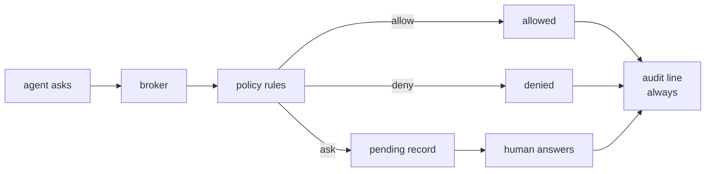

hangar &nbsp; P2

An agent that can edit files is an agent that can delete them. The permission
broker is the part of Acpilot that makes that sentence survivable.

## The model

Every request is classified — file write, file read, terminal, tool call, other —
and evaluated against rules scoped by agent, tool, and path. Unclassified
requests are treated as the strictest case, because "we did not recognise it" is
not a reason to allow it.

## Defaults

| Situation | Default |
| --- | --- |
| Read inside the workspace | allow |
| Write inside the workspace | **ask** |
| Anything outside the workspace | **deny** |
| Shell command that writes | **ask** |
| Unknown tool | **ask**, one request at a time |

<Aside type="note" title="Allow is a scope, not a mood">
`allow once` and `allow always` are different decisions with different audit
lines. The UI never offers a bare "allow" button, because "allow what, for how
long" is the only interesting question.
</Aside>

## The shadow-write guard

Writes are staged, not applied. The broker receives the intended content, checks
policy, and only then calls the host. If the policy says ask, the agent's call
**blocks** — it does not fail and retry, it waits, which is what keeps a
multi-file edit coherent instead of half-applied.

## Path canonicalisation

Every path is canonicalised before evaluation, on the host it belongs to:

- `..` segments resolved.
- Symlinks followed *once*, and a symlink that escapes the root is denied, not
  followed.
- Windows paths compared case-insensitively; POSIX paths not.
- WSL `C:\x` and `/mnt/c/x` treated as the same origin, because they are.

This is property-tested rather than argued about: the test suite generates path
pairs that must resolve identically or be denied together.

## Audit

Every decision is appended with who decided — `user`, `policy:<rule-id>`, or
`timeout` — and the request that produced it. The log is the difference between
"the agent did something" and "the agent did something and we can prove what".

## Status

Not started. The broker is P2-6 and lands before any UI can answer a request,
because a permission dialog without a broker is theatre.
