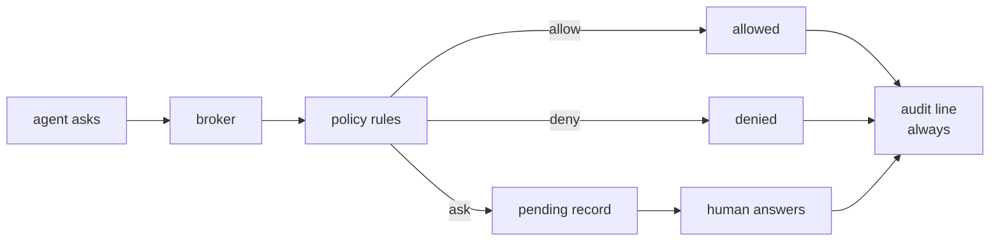

<span class="pill pill--boarding">boarding</span> &nbsp; P2

An agent that can edit files is an agent that can delete them. The permission
broker is the part of Acpilot that makes that sentence survivable.

## The model



Every request is classified — file write, file read, terminal, tool call, other —
and evaluated against rules scoped by agent, tool, and path. Unclassified
requests are treated as the strictest case, because "we did not recognise it" is
not a reason to allow it.

## Defaults

| Situation | Default |
| --- | --- |
| Read inside the workspace | allow |
| Write inside the workspace | allow |
| Anything outside the workspace | **ask** — refused if nobody is watching |
| Shell command, or any unknown tool | **ask**, one request at a time |

A write inside the workspace is allowed because P2 has no interface to ask
with; a profile that wants to be asked raises it with `[policy] default =
"ask"`, and the first client that can show a dialog ships with that as its
default.

<Aside type="note" title="Allow is a scope, not a mood">
`allow once` and `allow always` are different decisions with different audit
lines. The UI never offers a bare "allow" button, because "allow what, for how
long" is the only interesting question.
</Aside>

## The shadow-write guard

A write is decided before it is performed. The broker is given the path, the tool
and a line of detail, answers, and only then does the host write anything. If the
policy says ask, the agent's call **blocks** — it does not fail and retry, it
waits, which is what keeps a multi-file edit coherent instead of half-applied.
While it waits, the file is untouched: a diff is against the contents the editor
had open, and a crash leaves the disk as it was.

## Path canonicalisation

Every path is resolved on the host it belongs to — `..` segments collapsed,
symlinks followed — before it is compared with the workspace or matched against a
rule. Comparing the text an agent sent would pass `workspace/link`, which is a
path that looks contained and points at `/etc`; the test suite has exactly that
case. Globs fold case on Windows and do not elsewhere, because the platforms
differ there and a rule should mean the same thing on the machine it was written
for. Treating WSL's `C:\x` and `/mnt/c/x` as one origin is the Windows phase's
work, not this one's.

## Audit

Every decision is appended with who decided — `user`, `policy:<rule-id>`,
`default`, `session` (an earlier `allow always`), `timeout` or `unattended` — and
the request that produced it. The log is the difference between "the agent did
something" and "the agent did something and we can prove what".

## Rules

```toml
[policy]
default = "ask"
outside_workspace = "deny"

[[policy.rules]]
id = "allow-format"
decision = "allow"
tool = "execute"
path = "/work/repo/**"
```

Rules are tried in file order and the first match wins — no scoring, no
specificity contest. A rule may leave any of `agent`, `tool` and `path` unset,
which means "anything"; a glob is anchored and path-shaped, so `*` stops at a
separator and `**` does not. The audit line names the rule that fired, which is
the answer to every later argument about why something was allowed.

## Answering a request

A client that did not raise the request answers it over the API: the list is
`GET /v1/permissions?status=pending`, and the answer is
`POST /v1/permissions/{id}/resolve` with one of the options that same object
listed. Repeating the same answer returns the same decision; choosing a different
one is a conflict, because the agent has already acted on the first. The daemon
waits for as long as a request is pending — the five-minute deadline is the
broker's default for a session with no client at all, not a promise to anyone
watching.

## Status

The broker is P2-6 and is built: rules and globs, `allow always` scoped to one
session, an audit row per decision. P3-2 serves the pending list and the answer
route, and reads a profile's `[policy]` table at startup (`acpilotd --profile`),
so a rule in a file is a rule a running daemon obeys. What is not built: a UI
that shows the dialog (P5/P6), the SSE announcement of a new request, and
persistence — the audit log lives in memory until P3-7's table, and the
transcript (P2-8) is what survives a restart.
