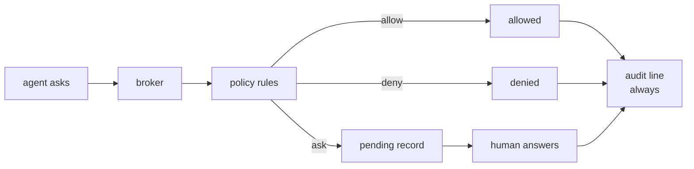

<span class="pill pill--boarding">boarding</span> &nbsp; Engine phase (P2)

An agent that can edit files is an agent that can delete them. The permission
broker is the part of Acpilot that makes that sentence survivable.

## The model



The broker classifies every request: file write, file read, terminal, tool call,
or other. It evaluates the request against rules scoped by agent, tool, and path.
The broker treats unclassified requests as the strictest case. "We did not
recognise it" is not a reason to allow it.

## Defaults

| Situation | Default |
| --- | --- |
| Read inside the workspace | allow |
| Write inside the workspace | allow |
| Anything outside the workspace | **ask** — refused if nobody is watching |
| Shell command, or any unknown tool | **ask**, one request at a time |

The engine phase (P2) has no interface to ask with, so the broker allows a write
inside the workspace. A profile that wants to be asked raises it with `[policy]
default = "ask"`. The first client that can show a dialog ships with that as its
default.

<Aside type="note" title="Allow is a scope, not a mood">
`allow once` and `allow always` are different decisions with different audit
lines. The UI never offers a bare "allow" button. "Allow what, for how long" is
the only interesting question.
</Aside>

## The shadow-write guard

The broker decides before the host writes. It receives the path, the tool, and a
line of detail. It answers. Only then does the host write anything. If the policy
says ask, the agent's call **blocks**. It does not fail and retry. It waits,
which keeps a multi-file edit coherent instead of half-applied. While it waits,
the host leaves the file untouched. A diff is against the contents the editor
opened, and a crash leaves the disk as it was.

## Path canonicalisation

The broker resolves every path on the host it belongs to before it compares the
path with the workspace or matches it against a rule. That resolution collapses
`..` segments and follows symlinks. Comparing the text an agent sent would pass
`workspace/link`, a path that looks contained and points at `/etc`. The test
suite has exactly that case. Globs fold case on Windows and do not elsewhere.
The platforms differ there, and a rule should mean the same thing on the machine
where you wrote it. Treating WSL's `C:\x` and `/mnt/c/x` as one origin is the
Windows phase's work, not this one's.

## Audit

The daemon appends every decision with who decided: `user`, `policy:<rule-id>`,
`default`, `session` (an earlier `allow always`), `timeout`, or `unattended`.
The daemon also appends the request that produced it. The log is the difference between
"the agent did something" and "the agent did something and we can prove what".

## Rules

```toml
[policy]
default = "ask"
outside_workspace = "deny"

[[policy.rules]]
id = "allow-format"
decision = "allow"
tool = "execute"
path = "/work/repo/**"
```

The broker tries rules in file order. The first match wins: no scoring, no
specificity contest. A rule may leave any of `agent`, `tool`, and `path` unset,
which means "anything". The matcher anchors a glob and treats it as path-shaped,
so `*` stops at a separator and `**` does not. The audit line names the rule that
fired. That name answers every later argument about why the broker allowed
something.

## Answering a request

A client that did not raise the request answers it over the API. The list is
`GET /v1/permissions?status=pending`. The answer is
`POST /v1/permissions/{id}/resolve` with one of the options that same object
listed. Repeating the same answer returns the same decision. Choosing a
different one is a conflict, because the agent has already acted on the first.
The daemon waits for as long as a request is pending. The five-minute deadline
is the broker's default for a session with no client at all. It is not a promise
to anyone watching.

## Status

We built the broker as task P2-6 of the engine phase: rules and globs,
`allow always` scoped to one session, and an audit row per decision. Task P3-2 of
the service phase serves the pending list and the answer route. It announces each
new request on `GET /v1/events`, so a client is told rather than polling. It
reads a profile's `[policy]` table at startup (`acpilotd --profile`), so a rule in
a file is a rule a running daemon obeys. Two things are not built. A UI that
shows the dialog is the command-line phase (P5) and the editor phase (P6).
Persistence is the service phase's P3-7 table. Until then the audit log lives in
memory. The transcript (engine phase, task P2-8) is what survives a restart.
