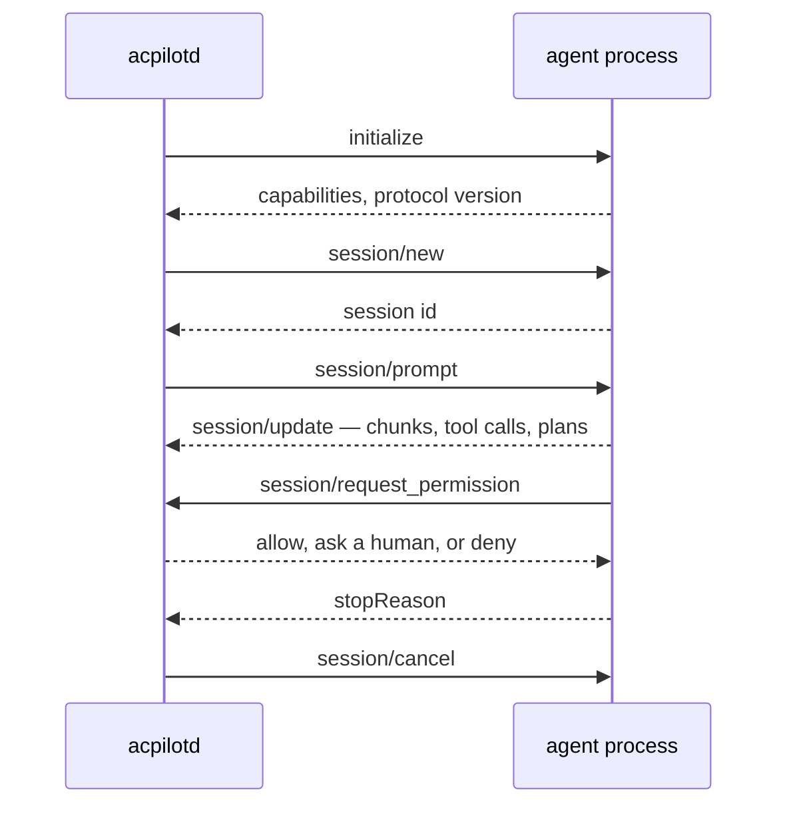

hangar &nbsp; P2

An **agent** is a program that can read your files, run commands, and write
changes, driven over a protocol instead of a chat window. Acpilot's native
protocol is the [Agent Client Protocol](https://agentclientprotocol.com) — the
same one Zed uses — so an agent written for ACP works here without an adapter.

## What the daemon does with an agent

Three things make this more than a pipe:

1. **The permission broker sits in the middle.** `session/request_permission`
   does not go to a UI as a toast; it becomes a pending record the daemon can
   audit, replay, and answer from policy.
2. **The filesystem callbacks go through the host.** When an agent asks to read
   a file, the daemon reads it from the host the workspace lives on — local, SSH,
   or WSL — not from whatever machine the daemon happens to be on.
3. **Every update becomes a sequenced event.** UIs render from the event stream,
   so a reconnecting client can replay and arrive at the same screen.

## Capabilities, not assumptions

Agents differ. The daemon records what each advertised during `initialize` and
the UIs adapt: an agent with no plan support gets no plan panel, not an empty
one. The same goes for `session/load` — if an agent cannot resume, the daemon
says so rather than pretending a restart is a resume.

<Aside type="caution" title="Protocol versions">
ACP v1 is the stable target. The v2 draft is tracked in an isolated module and
not adopted: an editor that chases a draft protocol twice a year is a science
project, not a tool.
</Aside>

## Model-backed agents

A local model is not an agent, but it can become one: a recipe tuned in the
[model lab](../../flight-test/) is promoted into an `acp-stdio` entry that runs
`acpilot-agent-lm`. The shim owns the conversation loop and reaches files,
terminals, and permissions only through the ACP callbacks above.

Which means the diagram on this page does not change. A model-backed agent is an
ordinary agent with an unusual prompt — same supervisor, same broker, same
transcript, same audit. That was the entire reason to build it that way.

## Trust

An agent is an arbitrary program with your repository and your network. The first
time a command is run it is hashed and pinned; if the binary changes, the agent
shows as **untrusted** until you say otherwise. This is not paranoia; it is the
same reason your shell asks before running a downloaded script.

## What is built today

The manifest and the process come first, because every later layer is built
against them. `agents.toml` is parsed and validated, secrets are resolved when
the profile loads, and the registry keeps one validated snapshot that a bad save
cannot half-replace. The supervisor starts an `acp-stdio` agent, keeps its stderr
in a bounded ring that is readable while it runs, restarts it on a crash when the
manifest says `on-crash`, and ends the process tree rather than only the wrapper
when a session closes.

`GET /v1/agents` lists what the daemon was given, in declaration order, with
`available` or `missing` from a `PATH` lookup on the daemon's host. That status
costs no process: listing agents cannot start one. A handshake-dependent
`unhealthy` or a trust-pinned `untrusted` arrives with sessions and trust storing,
not before.

A session is the client side of the protocol. It takes the supervisor's two
pipes and speaks ACP over them, so the same code serves a child process, an SSH
host, or a test. `initialize` completes before the handle is returned — no caller
holds a session whose capabilities it has not seen — and every `session/update`
becomes one numbered event before it is broadcast, so a slow subscriber drops
events but cannot renumber them. One turn runs at a time: a second prompt is
refused here rather than left to whatever an agent does with two. `session/cancel`
is a notification, so it reaches an agent mid-turn.

A permission request is classified — file read, file write, terminal, tool,
other — and handed to the broker, which answers from a rule, from the defaults,
or by asking a person. The agent's own option ids are used for the answer, so an
agent that called its allow option `yolo` receives `yolo`; a decision the agent
offered no option for cancels the request rather than inventing an approval. A
session with no broker refuses everything with the agent's own reject option,
because no grant should be implied by a session that has no policy. Either way
the answer is recorded as a notice, so the transcript says what the agent was
told. A request for a method this build does not implement — today,
`terminal/create` — is answered with `MethodNotFound` naming the method: not
advertising a capability does not stop an agent asking, and a request with no
answer is a hang, not a refusal. All of it is exercised against a mock agent that
runs as a real child process, so the pipes, the handshake and the tree kill are
run in CI rather than only type-checked.

## Files

An agent does not open files; it asks its client to. A session is given a
workspace, and `fs/read_text_file` and `fs/write_text_file` are served from it
through the same host seam the daemon edits and runs processes through — so the
same code reads a laptop's disk and, once the SFTP channel lands, an SSH
workspace's.

The path an agent asks about is resolved **on the host**, symlinks followed,
before it is compared with the workspace. Comparing the text that arrived would
miss `workspace/link`, which is a path that looks contained and points at `/etc`.
A relative path is refused rather than joined onto the workspace: the protocol
says absolute, and guessing a base directory turns an agent's bug into a file in
an unexpected place.

Reads outside the workspace are refused by name. Writes outside it are not
refused — they wait. The broker publishes a pending permission request, the turn
blocks, and the file is untouched until somebody approves it. That is the whole
point of calling it a shadow write: the old contents are still the contents
while the decision is open, so a diff can be shown against a file that has not
moved, and a crash leaves the disk as it was. Nothing is written speculatively
and rolled back, because a file restored by a rollback is not the same inode the
editor had open.

Two rules keep a blocked write from becoming a hang. If nothing is listening for
pending requests the write is refused immediately, since an approval that nobody
can give is not worth waiting for; and a request nobody answers expires after
five minutes. Either way the agent gets a denial, and the refusal is recorded as
a notice, so the transcript shows what the agent was told.

A session without a workspace advertises no filesystem at all, and refuses a
request that arrives anyway. The capability and the handler are one decision:
advertising something this client cannot serve is the same bug as refusing
something it advertised.

Terminals (P2-5) are not built yet, and the shipped policy is deliberately plain:
files inside the workspace are read and written, a shell or an unrecognised tool
is asked about, and anything outside is asked about too. A rule — `allow`, `ask`
or `deny`, optionally scoped by agent, tool and path glob — is how a workspace
narrows that, and every decision lands on the broker's audit log with the rule
that made it. `pty` and `http-jsonrpc` agents are accepted by the schema but refused
by the supervisor until their phases land, so the diagram above is still the
target, not a full description of today's daemon.
Model-backed agents arrive in P4.5, on top of the same layer, and inherit
whatever P2 gets right — or wrong — without a second implementation to blame.
