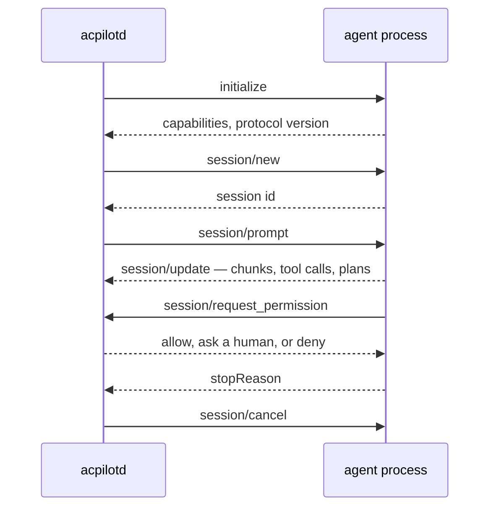

hangar &nbsp; P2

An **agent** is a program that can read your files, run commands, and write
changes, driven over a protocol instead of a chat window. Acpilot's native
protocol is the [Agent Client Protocol](https://agentclientprotocol.com) — the
same one Zed uses — so an agent written for ACP works here without an adapter.

## What the daemon does with an agent

Three things make this more than a pipe:

1. **The permission broker sits in the middle.** `session/request_permission`
   does not go to a UI as a toast; it becomes a pending record the daemon can
   audit, replay, and answer from policy.
2. **The filesystem callbacks go through the host.** When an agent asks to read
   a file, the daemon reads it from the host the workspace lives on — local, SSH,
   or WSL — not from whatever machine the daemon happens to be on.
3. **Every update becomes a sequenced event.** UIs render from the event stream,
   so a reconnecting client can replay and arrive at the same screen.

## Capabilities, not assumptions

Agents differ. The daemon records what each advertised during `initialize` and
the UIs adapt: an agent with no plan support gets no plan panel, not an empty
one. The same goes for `session/load` — if an agent cannot resume, the daemon
says so rather than pretending a restart is a resume.

<Aside type="caution" title="Protocol versions">
ACP v1 is the stable target. The v2 draft is tracked in an isolated module and
not adopted: an editor that chases a draft protocol twice a year is a science
project, not a tool.
</Aside>

## Model-backed agents

A local model is not an agent, but it can become one: a recipe tuned in the
[model lab](../../flight-test/) is promoted into an `acp-stdio` entry that runs
`acpilot-agent-lm`. The shim owns the conversation loop and reaches files,
terminals, and permissions only through the ACP callbacks above.

Which means the diagram on this page does not change. A model-backed agent is an
ordinary agent with an unusual prompt — same supervisor, same broker, same
transcript, same audit. That was the entire reason to build it that way.

## Trust

An agent is an arbitrary program with your repository and your network. The first
time a command is run it is hashed and pinned; if the binary changes, the agent
shows as **untrusted** until you say otherwise. This is not paranoia; it is the
same reason your shell asks before running a downloaded script.

## What is built today

Nothing in this page runs yet. P2 builds the registry, supervisor, and session
layer headless, tested against a mock agent, so the daemon is trustworthy before
a UI is built on top of it. Model-backed agents arrive in P4.5, on top of that
same layer, and they inherit whatever P2 gets right — or wrong — without a
second implementation to blame.
