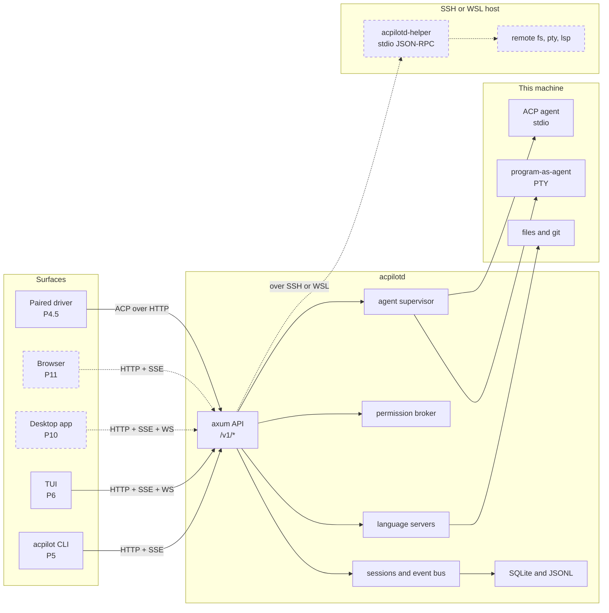
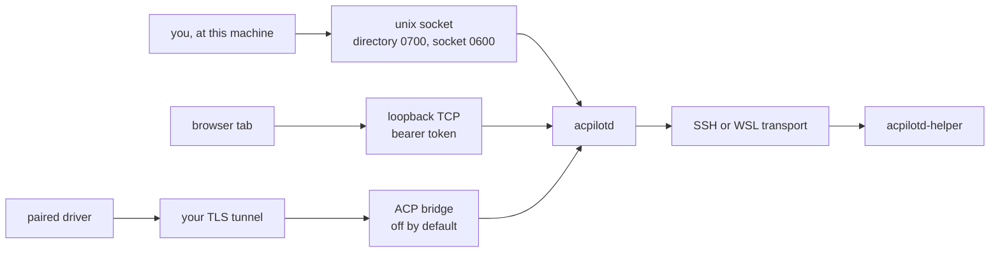

<span class="pill pill--boarding">boarding</span> &nbsp; Daemon, CLI and TUI (P3, P5, P6) &nbsp;·&nbsp; desktop (P10), web (P11), hosts (P8, P9)

Acpilot is a daemon and a set of thin clients. The clients are replaceable. The
daemon is where the work is: sessions, agent processes, permissions, terminals,
language servers, profiles and history. A TUI window is a view of that, not a
second copy of it.

That is the whole shape, and most of the rest of the manual is a consequence of
it. The sections below are the three questions the shape raises: what talks to
what, how a client finds the daemon. Who is allowed to cross which line.

## The map



Dashed is hangar: designed and recorded, not flown. The desktop shell and the web
editor are later phases. The helper is a design proven in the design phase
rather than a shipped transport. The map draws them because leaving them out
would make the architecture look smaller than it is.

Two rules keep the picture from turning into a mesh:

- **The daemon owns truth.** A UI owns its text buffer locally and applies edits
  optimistically. The daemon owns the file on disk, the conversation, and every
  decision. Agent writes reach a UI as events, not as a shared mutable document.
- **The transport is a trait.** Spawn a process, read a file, run a PTY, watch a
  directory: a session asks the host for capabilities, and `LocalHost`,
  `SshHost` and `WslHost` implement the same ones. This is why the helper in the
  corner does not get a second, worse file reader.

Every route takes `X-Acpilot-Profile`. On a mutating request, a daemon that
serves more than one profile requires it, so a client cannot act as the wrong
identity by accident. On a read or a stream, leaving it out means the active
profile, and a stream stays bound to the profile it was opened with.

## How a UI attaches

There is no service discovery, no mDNS and no port scan. The endpoint is a
platform rule: a unix socket in the runtime directory where the platform has
one, loopback HTTP where it does not. `ACPILOT_API_URL` names another one. The
daemon binds what the client probes because both ask `acpilot-host`.

```mermaid
sequenceDiagram
    autonumber
    participant C as Client
    participant L as Spawn lock
    participant D as acpilotd
    C->>D: GET /v1/health, 300 ms
    alt it answers
        D-->>C: ok, version, profile, workspace
    else it answers 401
        D-->>C: refused
        Note over C: stop and name the token file
    else nothing answers
        C->>L: take the lock for this endpoint
        C->>D: spawn the sibling acpilotd, detached
        loop every 50 ms, up to 2 s
            C->>D: GET /v1/health
        end
    end
    C->>C: compare the daemon version with its own
    alt they differ
        Note over C: refuse; never restart a daemon mid-turn
    else they match
        C->>D: attach with after, SSE or WebSocket
        D-->>C: replay, then live
    end
```

The three probe answers are deliberate. Silence means "start it". A `401` means
"the daemon is right there and your token is wrong", and starting a second one
would answer the wrong question. Both reported as "no daemon" is how a person
ends up with two.

A client that starts the daemon takes a lock first, because two windows opening
at once is a normal login, not an attack. It starts `acpilotd` from beside its
own executable, never from `PATH`. Detaches it into its own process group so
closing the window that happened to start it does not end every session. The
daemon's output goes to a log beside the lock, because a process that dies four
milliseconds after spawning otherwise leaves nothing to read.

`acpilot tui` can also run that same core inside its own process when nothing
answers (P6-11). Nothing needs installing, and the sessions it opens end with
the window. `--no-spawn` refuses to start anything at all: it is what a test, a
service manager and somebody debugging a startup failure actually want.

The version check is equality, and a mismatch is a refusal rather than a
restart. The daemon may be mid-turn for a session somebody else is watching.
Killing it to satisfy a newer client would throw that turn away, so the client
stops and says which version is on each end instead.

## Trust boundaries



| Boundary | Who may cross it | What proves it |
| --- | --- | --- |
| Unix socket | the same user | the runtime directory is `0700` and the socket `0600`. The filesystem is the access control, so no token is needed |
| Loopback TCP | the holder of the bearer token | the token is generated at bind, written to a `0600` file beside the socket, and required on every request — including loopback |
| ACP bridge | a paired driver | a single-use pairing code that expires in two minutes. A bearer token is kept only as an Argon2id hash, with scopes and a 60 request/minute limit |
| Your TLS | whoever your tunnel or reverse proxy admits | not Acpilot's: the daemon does not stop TLS in v0.1. The docs say so instead of implying an `https` that is not there |
| SSH or WSL helper | the daemon that uploaded it | the helper is embedded in `acpilotd`, written over the transport already open. The handshake refuses a protocol number that is not the daemon's |

The bridge is the only thing here that is off by default, and enabling it
requires an explicit bind address. An enabled bridge with no bind is a startup
error. A listener that is unauthenticated on one address is one config edit away
from being unauthenticated on another. That is why the driver token is required
even on loopback.

The driver's default scopes are `observe`, `prompt` and `cancel`.
`answer_permissions` is a separate decision made by the person when the pairing
code is issued. Without it, a request raised by the driver's turn stays on the
pending list for a human. The driver is told once per turn that this is
what is happening. The bridge changes who is typing, not what is allowed. The
full story is in [Remote control](../../flight-test/remote-control/).

The page at `/` is served without a token because a browser cannot attach a
header to an address a person typed. It holds no data: one HTML file, the
version, and two buttons. The editor, transcript and terminal are the web
phase's (P11), and they will not arrive by quietly putting a token in a query
string.

## What is built

| Surface | State | What exists now |
| --- | --- | --- |
| Daemon and API | flying | axum routes, SSE and WebSocket streams, permission broker, SQLite and JSONL history |
| CLI | flying | every command is a typed call to the API, with `acpilot api` as the escape hatch |
| TUI | flying | editor, transcript, terminals and permission prompts over the same API |
| Embedded daemon | flying | `acpilot tui` with nothing installed. Sessions end with the window |
| ACP bridge | boarding | local `--acp` transport, HTTP driver transport, pairing, scopes, revocation |
| Desktop | hangar | the shell crate builds. The daily-driver work is P10 |
| Web | hangar | the daemon serves a status page. The editor is P11 |
| SSH and WSL hosts | hangar | the helper round-trip and path translation were proven in P0. The transports are P8 and P9 |

A page that claims more than this table is a bug, and the pill at the top is the
short version of the table.

## Where the pieces are documented

- [Sessions](../sessions/) — one conversation, several viewers, and who may answer.
- [Hosts: SSH and WSL](../hosts/) — where the files and the helper actually live.
- [Remote control](../../flight-test/remote-control/) — the bridge in full.
- [Permissions](../../safety/permissions/) — what the broker decides on its own.
- [Profiles](../profiles/) — why the identity is an argument, not ambient state.
