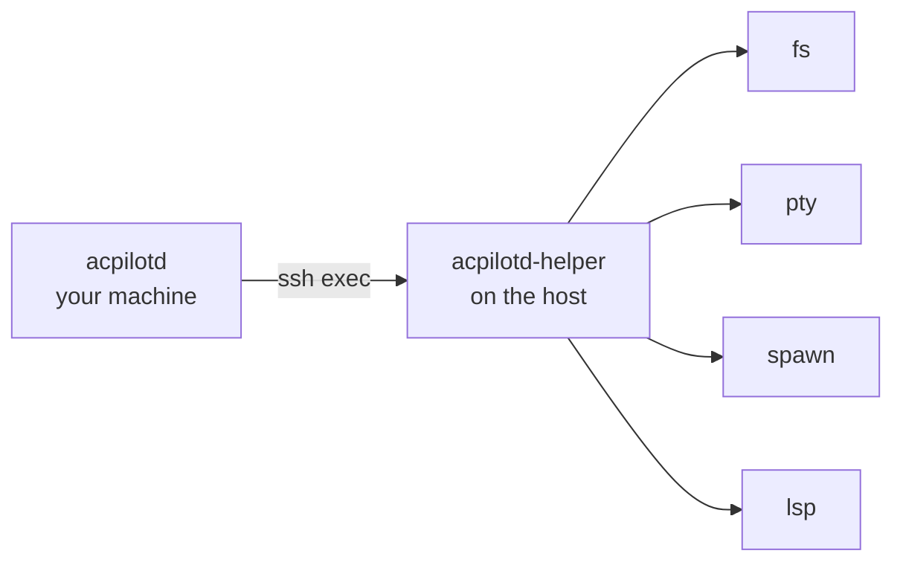

<span class="pill pill--hangar">hangar</span> &nbsp; Remote hosts phase (P8, SSH) &nbsp;·&nbsp; Windows phase (P9, WSL)

A **host** is a machine with a filesystem and processes. Local is a host. An SSH
box is a host. A WSL distribution is a host. A workspace lives on one, and
everything runs there: files, terminals, agents, and language servers.

## One trait, three implementations

```rust
trait Host {
    async fn read(&self, path: &str) -> Result<Vec<u8>>;
    async fn write(&self, path: &str, bytes: &[u8]) -> Result<()>;
    async fn spawn_pty(&self, cmd: &Command, size: Size) -> Result<Pty>;
    async fn spawn_agent(&self, spec: &AgentSpec) -> Result<Child>;
}
```

The point is not abstraction for its own sake. A remote agent must not get a
second, worse implementation of "read a file". The shadow-write guard, the path
canonicalisation, and the audit log have to apply identically.

## The helper

For SSH and WSL, the daemon uploads a small static binary (`acpilotd-helper`) and
talks JSON-RPC to it over stdio. Filesystem calls, PTYs, and spawns happen on the
far side of the connection. There the latency is zero instead of per-syscall.

The helper travels **inside** `acpilotd`. A release build compiles it for musl
and embeds the bytes. The first connection to a host writes them to
`~/.local/bin/acpilotd-helper` over the transport that is already there. That is
one `sh -s` reading a base64 payload on stdin. There is no `scp`, no package
manager, and no question about which version is on the host. The handshake
refuses a helper whose protocol number is not the daemon's, and the daemon put
the file there, so it knows. A host that already has a helper on its `PATH` still
works. Every test and developer build is that case. A host that refuses the write
falls back to it.



<Aside type="caution" title="The Windows-specific reason">
`\\wsl.localhost\Ubuntu\...` works, and it is how you lose an afternoon. Every
file operation pays a 9P round trip. Talking to a helper inside the distribution
is not a clever workaround. It is the only version that feels like a local
editor.
</Aside>

## A language server over the helper

A workspace on a host gets its language server **there**, not here. `lsp.start`
runs the detected program (`rust-analyzer`, `pyright-langserver`, or
`typescript-language-server`) with pipes rather than a PTY. LSP is already
framed, and a terminal would add echo and CRLF translation the protocol never
asked for. The daemon sends its own `initialize` through `lsp.write` and reads
the answers as `lsp.data`. The protocol above the pipe is therefore the same code
that talks to a server on this machine. The server indexes the root as the host
spells it. That is why a reference in a second file is a line on that machine.
It is also why a workspace this daemon cannot see still gets scoped references.

One helper process per server, for the same reason a terminal gets one. A server
speaks when it finishes indexing, and that must not queue in front of a file
read on the shared connection. The daemon remembers a server that cannot start as
absent until it restarts, exactly as it does for a local server.

## A terminal over the helper

The same helper opens real PTYs. `pty.open` answers with an id and streams the
program's output back as notifications. `pty.write`, `pty.resize`, and `pty.kill`
drive it. Each pane gets its own helper process, because a terminal's output
arrives between requests and must not queue in front of a file read. The daemon's
reader sorts replies from output by shape. The screen, the replay on attach, and
the exit notice are the daemon's, unchanged. A remote pane is not a second kind of
pane.

## What the helper preserves

- **Path spelling.** The daemon stores a path as the host spells it. Translation
  happens at the edges (clipboard, file dialogs, `--file` arguments), never in
  the middle.
- **Line endings.** CRLF files stay CRLF. A save is a write, not a conversion.
- **Exit codes and signals.** A killed command is a killed command, not a
  generic failure.

## Remote watching is polling

Until inotify-over-SSH exists, a remote workspace watches by polling (500 ms,
coalesced) with ETag revalidation. The UI shows a "remote" indicator. A stale
tree that looks live is worse than a tree that admits it is a poll.

## Status

Not started. The design phase's P0-4 proves ACP over an SSH exec channel. P0-5
proves the helper round-trip and path translation. The remote hosts phase (P8)
and the Windows phase (P9) build on both.
