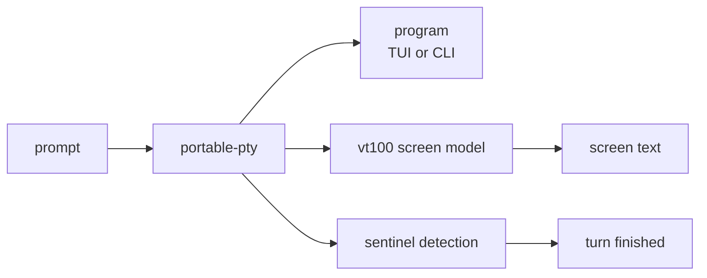

<span class="pill pill--hangar">hangar</span> &nbsp; P2

Most agents do not speak ACP. Some of the best ones are just programs: they take
a prompt, print a transcript, and wait. Acpilot can fly those too, by giving them
a PTY and reading the screen.

This is the feature that makes "run anything" true instead of aspirational. It is
also the one most likely to be brittle, so it is built with the assumption that
parsers will need adjusting.

## How it works



1. Spawn the program in a PTY, sized to a known grid, and answer the terminal
   queries it asks (`CSI ? u`, `CSI > 0 q`, `CSI c`, `CSI 6 n`). A bare PTY is not
   a terminal, and the program on the other end is entitled to notice.
2. Clear the startup gates — trust dialog, "wrong directory" modal, login — which
   is a per-program step, not a timeout.
3. Write the prompt, wait a beat, then send the submit key **in its own write**.
   A single write of `text\r` is treated as one paste by at least one TUI: the
   words appear in the box, nothing is submitted, and the screen looks idle.
4. Detect the end of a turn from the program's sentinel — the input row going
   empty again — with a generous idle timeout as the backstop, never as the
   primary signal.
5. Capture the screen **at the sentinel**, strip the chrome, and emit events.
   Both programs measured during P0-2 run on the alternate screen: after the
   child exits, the terminal holds nothing at all.

<Aside type="note" title="Alternate-screen programs are the hard case">
A program that owns the alternate screen and repaints everything is easy to
render and hard to parse — and it takes the transcript with it when it exits.
That is why the screen is captured at the sentinel, why the adapter ships with
two parsers (`plain-transcript`, `ansi-transcript`), and why per-program profiles
are data, not code: you can fix a parser without a release.
</Aside>

## What it cannot do

- **Structure.** A PTY gives you pixels-as-text, not tool calls. You get a
  transcript, not a typed event stream. Plans, diffs, and rewinds stay a native
  ACP privilege.
- **Precision.** "Turn finished" is a heuristic, and it can be wrong in either
  direction. An idle timeout short enough to feel fast cut the answer in half in
  four of five measured turns; a timeout long enough to be safe adds five seconds
  to every turn. Only the program's own sentinel gets both.
- **Guarantees.** If a program changes its prompt, the sentinel changes with it.
  The failure is visible and fixable; it is not silent.

## Configuration

```toml
# agents.toml
[[agents]]
id = "freebuff"
transport = "pty"
command = "freebuff"
args = []
parser = "ansi-transcript"
prompt_row = "▍Enter a coding task"   # where the input lives
sentinel = "▍Enter a coding task"     # and what it looks like when idle
exit_command = "/exit"
idle_timeout_ms = 5000                # backstop only; the sentinel ends the turn
```

The reference case in the test suite is `freebuff`, because a program that is
itself an agent is the honest way to test a "run anything" claim.

## Status

Designed, prototyped, not built. P0-2 drove `freebuff` and Claude Code through a
real turn each under one driver; the transport turned out to be generic and the
semantics per-program, which is why the adapter is a profile rather than a
parser heuristic. The numbers and the failure modes are in
`docs/notes/pty-agents.md`. The adapter itself is P2.
