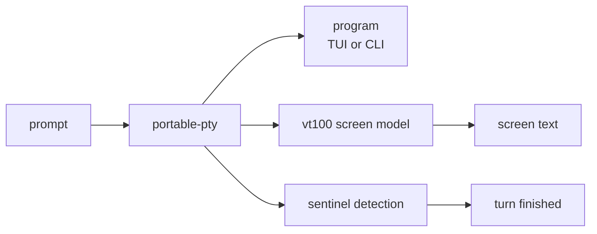

<span class="pill pill--hangar">hangar</span> &nbsp; P2

Most agents do not speak ACP. Some of the best ones are just programs: they take
a prompt, print a transcript, and wait. Acpilot can fly those too, by giving them
a PTY and reading the screen.

This is the feature that makes "run anything" true instead of aspirational. It is
also the one most likely to be brittle, so it is built with the assumption that
parsers will need adjusting.

## How it works



1. Spawn the program in a PTY, sized to a known grid.
2. Write the prompt, then wait.
3. Detect the end of a turn by watching for a sentinel: the input prompt
   reappearing, or an idle timeout when there is no prompt to watch.
4. Read the screen back as text, strip the chrome, and emit events.

<Aside type="note" title="Alternate-screen programs are the hard case">
A program that owns the alternate screen and repaints everything is easy to
render and hard to parse. That is why the adapter ships with two parsers
(`plain-transcript`, `ansi-transcript`) and why per-program profiles are data,
not code — you can fix a parser without a release.
</Aside>

## What it cannot do

- **Structure.** A PTY gives you pixels-as-text, not tool calls. You get a
  transcript, not a typed event stream. Plans, diffs, and rewinds stay a native
  ACP privilege.
- **Precision.** "Turn finished" is a heuristic. When it is wrong, it is wrong in
  the direction of waiting too long, never of cutting a turn short.
- **Guarantees.** If a program changes its prompt, the sentinel changes with it.
  The failure is visible and fixable; it is not silent.

## Configuration

```toml
# agents.toml
[[agents]]
id = "freebuff"
transport = "pty"
command = "freebuff"
args = []
parser = "ansi-transcript"
sentinel = "> "
idle_timeout_ms = 600000
```

The reference case in the test suite is `freebuff`, because a program that is
itself an agent is the honest way to test a "run anything" claim.

## Status

Designed, not built. P0-2 prototypes it against two real programs before P2
commits to the adapter shape.
