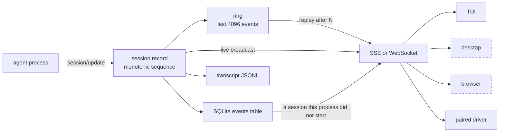
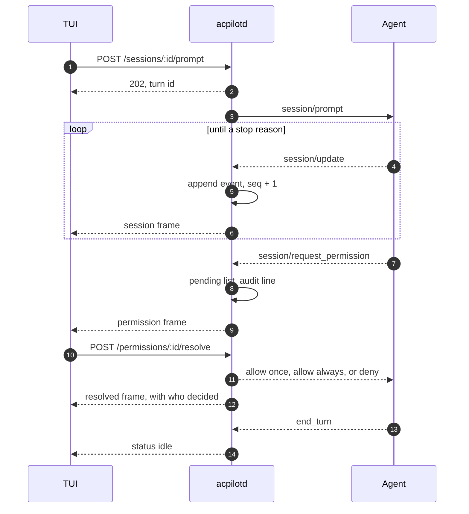
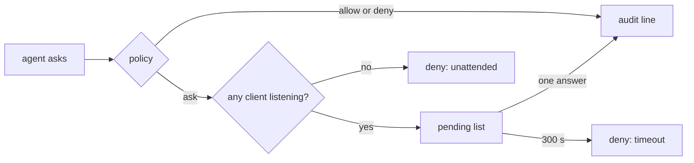

boarding &nbsp; Session bus and streams (P3) &nbsp;·&nbsp; driver scopes (P4.5-10)

A session is one ACP conversation: `session/new`, prompts, updates, tool calls and
a stop reason. It lives in the daemon, not in a window. The TUI that started it
can close, the desktop app can open it. A paired driver can watch the same
turn without any of them handing a file to another.

That is what "sharing a session" means here. There is no session-sharing
protocol, no invite link and no copy of the conversation on a second machine.
There is one record and however many clients attached to it.

## One record, many readers

Every event gets the next sequence number before anything else happens to it.
The live feed is a broadcast channel: every subscriber receives every event, and
none of them can consume another's copy. A subscriber that asks for `after=N`
gets the ring's events with `seq > N`, then the live feed. The SSE route also
reads `Last-Event-ID`, which is what an `EventSource` sends when it reconnects.
A browser tab that was asleep asks for the right place without any extra
bookkeeping.

The order is subscribe first, then read the ring. It looks like a detail and is
actually the fix for a lost-event window: the ring is written before the
broadcast. An event landing between a replay and a later subscription would
be in neither. The reconnecting client would wait for a turn that had
already finished. Subscribing early queues the event. A `seq <= last` check drops
the one-event overlap this creates.

The ring holds 4 096 events. A client further behind than that is not silently
given a transcript with a hole: it receives a `resync` frame carrying the latest
sequence. Starts again from there. A heartbeat every 15 seconds proves the
stream is alive. The WebSocket route uses a ping instead of a frame, because a
client's `onmessage` should see events.

A conversation the daemon did not start in this process is history, not a live
session. Its stream replays the SQLite rows and then ends. That is the honest
difference between a session and a transcript. It is why the same reconnect
that works mid-turn also works after a restart. With nothing further to wait
for.

## A turn, end to end

A prompt returns `202` with a turn id rather than waiting for the agent. A
retried prompt with the same `idempotency key` is the same turn. A second prompt
while a turn is in flight is refused rather than queued, because two prompts
racing in one conversation is not a feature.

The permission step is in the middle of the turn on purpose. The agent blocks
until somebody answers, and the daemon keeps the question as state rather than
as a frame that may have been missed. `GET /v1/permissions?status=pending` is the
list, and a window that opens after the request was raised sees it.

## Who may answer

One broker serves every session in the daemon. It has one pending list, one
policy and one audit log, because two brokers would mean two answers to "is
anybody waiting?".

The pending list is not a queue of notifications. A decision removes the entry
before the answer is delivered, so the first resolve wins. Repeating the same
answer is idempotent. A different one is `409`. The other windows are told the
question is settled so they can close a dialog nobody needs to read twice.

Every decision is audited with who made it: `user`, `policy:<rule>`, `default`,
`session`, `timeout` or `unattended`. The last two are refusals. If nothing is
subscribed to the broker's announcements, a request that needs a person is
refused as `unattended`. It does not wait for a viewer that does not exist. If a
viewer exists but says nothing for five minutes, the answer is `timeout`.

| Actor | May watch | May prompt | May answer |
| --- | --- | --- | --- |
| a person at any UI | yes | yes | yes |
| a paired driver | yes | yes, with `prompt` | only with `answer_permissions` |
| the agent | its own turn | — | no |

A driver owns the sessions it opened. Another driver's prompt, cancel or
permission answer is refused rather than typed into a conversation it did not
start. The default driver scopes are `observe`, `prompt` and `cancel`. The grant
to answer is made by the person when the pairing code is issued, never by the
driver asking for it. Without the grant, the request waits on the pending list
for a human and the driver is told once per turn why it is waiting.

The rest of the broker's rules — what is allowed inside a workspace, what is
asked outside it, what a session grant covers — are in
[Permissions](../../safety/permissions/).

## What is not here

- **No collaborative editing.** Two people can watch one session and one of them
  can type. They cannot edit the same buffer with CRDTs. That is a v0.1
  non-goal, not an oversight.
- **No cross-daemon session migration.** A session belongs to the daemon that
  opened it. Copying a live conversation to another machine would be a second
  implementation of the event log, which is exactly what this page exists to
  avoid.
- **No replay of a live session after the daemon exits.** The transcript is
  still there and still replays. The conversation is not resumed. Resume is on
  the roadmap, and until it ships this page says so.
